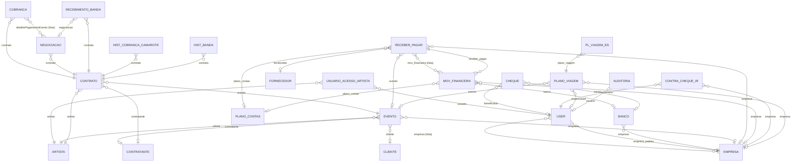
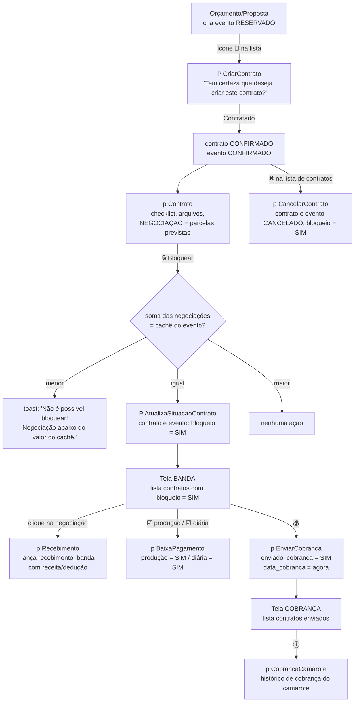
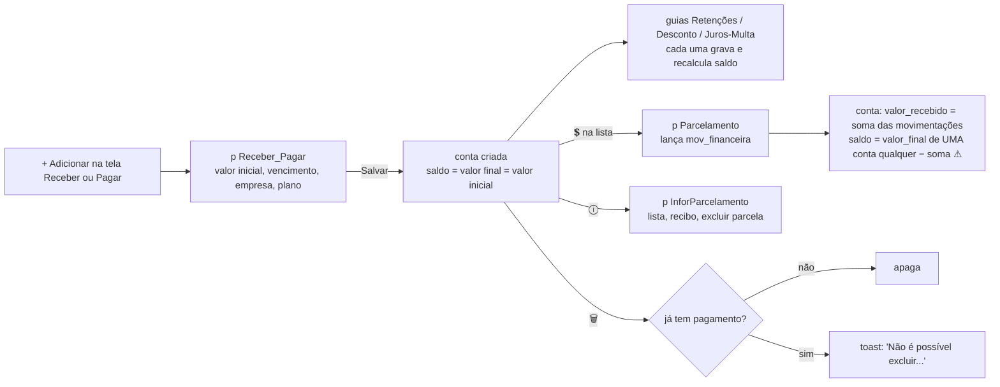

# Camarote Shows — Especificação consolidada para refatoração
### Bubble → Next.js + Supabase + Vercel

| | |
|---|---|
| App lido | `camarote-shows-refatorar` (cópia do app de produção `camarote-shows-web-73474`) |
| Versão lida | `test` (a cópia não tem `live` — ver §15) |
| Data da leitura | 14/10/2026 |
| Modo | somente leitura; nenhum registro de dados foi aberto, só a estrutura |

Este é o **documento único** para iniciar a refatoração. Ele substitui as versões anteriores do relatório e reúne: inventário, modelo de dados, permissões, navegação, fluxo de negócio, cada tela com campos/botões/gravação, mensagens, fórmulas, regras, bugs, schema Supabase com RLS, plano de reconstrução e a matriz do que foi e do que não foi lido.

## Como ler

| Marca | Significado |
|---|---|
| **[L]** | Lido literalmente no editor do Bubble (estrutura, expressão, texto ou configuração exatamente como está). |
| **[I]** | Inferido: conclusão a partir do que foi lido ou do comportamento conhecido do Bubble. Confirmar antes de agir. |
| **[NV]** | Não verificado. Tudo que é NV está listado em §19. |

- Nomes em `monoespaçado` são os nomes reais no Bubble (elemento, campo, tipo, estado). Use-os como referência ao reconstruir.
- Rótulos de tela vêm do nome automático do elemento de texto no Bubble, que guarda o começo do texto exibido; alguns aparecem truncados.
- "*" ao lado de um rótulo = rótulo marcado em vermelho na tela (obrigatório visualmente). Alguns dropdowns também têm "Make required" ligado; isso é indicado quando lido.

## Sumário

1. Resumo executivo
2. Inventário
3. Modelo de dados
4. Privacidade e permissões
5. Navegação (menu → tela, e o que não abre)
6. Fluxo de negócio ponta a ponta
7. Telas — casca, login e padrões
8. Telas — Cadastros
9. Telas — Evento (orçamento, contrato, agenda, localização)
10. Telas — Banda e Cobrança
11. Telas — Financeiro
12. Telas — RH, Auditoria, Dashboard, Mobile
13. Catálogo de mensagens
14. Cálculos e fórmulas exibidas
15. Padrão visual, formatos e comparação test × live
16. Regras de negócio consolidadas
17. Achados e bugs por severidade
18. Schema Supabase com RLS e plano de reconstrução
19. Matriz de cobertura e "Não verificado"

---

## 1. Resumo executivo

O Camarote Shows é um ERP de agenciamento de shows. Cadastra artistas, contratantes, clientes, fornecedores e empresas do grupo; registra eventos (orçamento → reserva → contrato); acompanha a negociação e o recebimento da banda e a cobrança do camarote; tem financeiro (contas a receber/pagar com parcelas, retenções, movimentação, cheques, plano de contas), RH (contracheque/IR) e auditoria. Tudo roda numa única página, `dashboard`, que troca de tela mostrando e escondendo grupos pelo estado `SubMenu` **[L]**.

### O que mais pesa

**Segurança [L]**
- Contas a receber/pagar, movimentação, bancos (agência/conta), cheques, contracheques **com arquivos**, plano de viagem, auditoria e cadastro de usuários estão com privacidade "everyone": qualquer pessoa, mesmo sem login, pode ler pelas regras.
- Não há controle por perfil no servidor. Na tela, os itens de menu já começam visíveis para todos e as condições comparam "Administrador" com o rótulo real "ADMINISTRADOR". As telas não checam perfil.
- A senha temporária de novos usuários vai em texto no e-mail.

**Dados gravados errados [L]**
- Saldo da conta a receber/pagar recalculado a partir de uma busca sem filtro, que pega uma conta qualquer.
- Pagamento avulso grava **sem valor, banco, empresa, forma de pagamento, plano e tipo** — só data, descrição e anexo.
- Editar um banco altera **o primeiro banco da empresa**, não o selecionado.
- Atualizar o contrato não grava os valores de "Renegociação" (cachê, produção, imposto etc.) mostrados no mesmo popup.

**Telas que não funcionam [L]**
- Cheque, Contracheque/IR, Auditoria, Plano de viagem, "Pagar/Receber" e "Forma de Pagamento": os itens de submenu só mudam o destaque do menu, **não abrem a tela**. Cheque e Contracheque/IR, além disso, estão montados sobre tipos de dados apagados e não gravam nada.
- Gráficos da aba "Indicadores" apontam para tipos e option set apagados.
- Layout de computador só aparece em Windows; em Mac/Linux vem a versão mobile, que não tem botão de sair.
- Popups sem acesso: `p Cobranca`, `P ArquivoExc` e `ParcelasCriadas` não têm workflow que os abra (e o de arquivo, se abrisse, apagaria sempre o T.R.).

**O que funciona e precisa ser preservado [L]**
- Fluxo de evento → contrato (1 clique) → negociação em parcelas → bloqueio do contrato só quando a negociação soma exatamente o cachê → recebimentos da banda com retenções → baixa de produção/diária → envio para cobrança → histórico de cobrança do camarote.
- Proteções de exclusão: empresa só sai sem bancos/eventos/contas; artista, cliente e contratante só saem sem eventos; fornecedor só sem contas; conta só sai sem pagamentos.
- Validações: CPF/CNPJ duplicado (cliente, fornecedor, contratante), conflito de data por artista, bloqueio de agenda contra evento existente, recebimento acima do saldo da negociação, parcela acima do saldo.

**Comparação test × live:** impossível nesta cópia (plano Free, sem versões) **[L]**. Ver §15.
## 2. Inventário

### 2.1 Plano e plataforma [L]
| Item | Valor |
|---|---|
| Plano | Free |
| Data API | desativada (`api: false`) |
| Scheduler | sim |
| Data triggers | **não** (o backend workflow `teste` não roda neste plano) |
| Branches | 0 |
| Expõe API de workflows | sim (`exposesWfApi: true`) |

### 2.2 Páginas [L]
| Página | Título | Largura | Papel |
|---|---|---|---|
| `index` | Camarote Shows - Login | full width (1200) | Login e "redefinir senha" |
| `dashboard` | Camarote Shows - Dashboard | 1080 | App inteiro (SPA por estados) |
| `reset_pw` | Camarote - Resetar Senha | 1080 | Nova senha via link |
| `404` | **App Taty Girl - 404** | 1080 | Página de erro (título herdado de outro app) |

### 2.3 Views mobile (app nativo) [L]
| View | Conteúdo |
|---|---|
| `Home` | vazia (sem elementos, sem workflows) |
| `update_app` | modelo padrão do Bubble, com o reusable `offline_banner` [L] |
| `reset_password` | modelo padrão do Bubble, com o reusable `offline_banner` [L] |

### 2.4 Reusables [L]
- `Signup / Login Popup` — popup de login antigo (login, "esqueci a senha", toast, ir para dashboard), com workflows nomeados "Button C/G is clicked" [L]. Se é usado em alguma página: [NV].
- `offline_banner` — do modelo padrão do Bubble, usado nas views mobile [L]; pelo nome, aviso de "sem conexão" [I]. Não precisa ser reconstruído [I].

### 2.5 Backend workflows [L]
| Nome | Tipo | O que faz |
|---|---|---|
| `teste` | Database trigger em `contratante` | Cria `auditoria` com usuário, data, "antes" e "depois" do contratante. **Não roda no plano Free.** |
| `Autenticação` (`login_api`) | API workflow **público, sem autenticação** | Recebe `email ` (com espaço no fim do nome) e `password` e faz "Log the user in" (stay logged in = não). |

### 2.6 Tipos de dados (23) [L]
artista, auditoria, banco (`banco1`), cheque (`cheque1`), cobranca, contra_cheque_ir, contratante, contrato (`contrato1`), detalhe_historico_cobranca_camarote (`detalhe_historico_cobranca`), detalhe_historico_banda (`detalhe_historico_cobranca1`), negociacao (`detalhepagamentoevento`), empresa (`empresa1`), cliente (`empresa2`), fornecedor (`empresa3`), evento, mov_financeira, recebimento_banda (`negociacao`), pl_viagem_entrada_saida, plano_contas, plano_viagem (`plano_viagem1`), receber_pagar, usuario_acesso_artista (`usuarioacessoartista`), User, Device (estático do Bubble).

### 2.7 Option sets (18) [L]
Banco, Tipo Empresa, Perfil, Status, Contrato, Financeiro, Movimentacao, Status Contrato, Receitas_Deducoes, Forma de Pagamento, Status Evento, Status da Cobranca, Status do Documento, Tipo de Agendamento, Pag Evento_Camaronte, Tipo de Movimentacao, tipo_contra_cheque_ir, Categoria Financeiro Evento. Opções completas em §3.4.

### 2.8 Plugins (31) [L]
Ionic Elements, Chart Element, Multiselect Dropdown, Full Calendar, API Connector, Google Material Icons, Toolbox, Air Date Time Picker, Apex Chart Lite, Input Formatter, Search & Autocorrect, Brevo (Sendinblue), myAlerts! (usado em todos os toasts "5. Custom Toast"), Fuzzy search & Autocomplete, Open URL In New Tab, openToast, CPF/CNPJ Validator, Open URL in custom Window, Formatador de Inputs Brasil, Local Storage & Cookies, Better Calendar Time Slots, Google Charts, PDF Viewer, Better Native Camera & Webcam, Gerar PDF / Imprimir, Browser Device Information · BEP (decide desktop × mobile), Better Toast Notifications/Alerts, Export to XLSX(excel), PDF Conjurer, Supabase Event Trigger, Lan Criptografar.

Equivalentes no Next.js: toasts → `sonner`; calendário → `@fullcalendar/react`; gráficos → `recharts`; XLSX → `exceljs`/`xlsx`; PDF → `@react-pdf/renderer`; máscaras e CPF/CNPJ → `react-imask` + validação própria; e-mail → Resend ou Brevo via API **[I]**.

### 2.9 Estilos [L]
Body Copy, H1/H2/H3 Light, TituloCaixa, InputPadrao **e** inputPadrao (duplicados), Standard Icon, Default group, Standard input, Standard popup, GrupoEmptyState, Default Repeating Group, BTN_Confirmar_Lilas (id `Text_btn_confirmar_azul_`), Standard Dropdown, Standard uploader, agenda (FullCalendar), Standard Date Picker, Standard Search, Standard Multiline Input.

### 2.10 Workflows por página [L]
| Página | Workflows (aprox.) |
|---|---|
| index | 7 |
| dashboard | ~380 |
| reset_pw | 2 |
| 404 | 0 |
| backend | 2 |

---

## 3. Modelo de dados

### 3.1 Tipos e campos (chave Bubble → rótulo → tipo) [L]

Todos os tipos também têm `Created By` (user), `Created Date`, `Modified Date` e `Slug`.

**User** (`user`)
| Chave | Rótulo | Tipo |
|---|---|---|
| email | email | text (nativo) |
| complemento_text | **nome** | text |
| resposanvel_text | **apelido** | text |
| celular_text | fone | text |
| foto_image | foto | image |
| perfil_option_perfil0 | perfil | Perfil |
| status_option_status0 | status | Status |
| empresa_list_custom_empresa1 | empresa | lista de empresa |
| empresa_padrao_custom_empresa1 | empresa_padrao | empresa |
| pode_visualizar_relatorios_boolean | pode_visualizar_relatorios | sim/não |

**artista** (`artista`): nome_text, email_text, celular_text, responsavel_text, comissao_camarote_number, imposto_number, status_option_status0.

**contratante** (`contratante`): nome_text, cpf_cnpj_text, email_text, celular_text, responsavel_text, observacoes_text, status_option_status0.

**empresa** (`empresa1`), **cliente** (`empresa2`), **fornecedor** (`empresa3`) — mesma estrutura: nome_text, cnpj_text (rótulo "cpf_cnpj" em cliente/fornecedor), email_text, fone_text, endereco_geographic_address, numero_text, complemento_text, responsavel_text, status_option_status0. Só `empresa1` tem `padrao_boolean`.

**banco** (`banco1`): nome_text, codigo_text, agencia_text, conta_text, empresa_custom_empresa1.

**evento** (`evento`)
| Chave | Rótulo | Tipo |
|---|---|---|
| nome_evento_text | nome_evento | text |
| agendamento_option_tipo_de_agendamento | tipo_agendamento | Tipo de Agendamento |
| artista_custom_artista | artista | artista |
| contratante_custom_contratante | contratante | contratante |
| cliente_custom_empresa2 | cliente | cliente |
| empresa_custom_empresa1 | empresa | empresa |
| data_hora_inicio_date | data_hora_inicio | date |
| endereco_geographic_address | endereco | geographic address |
| local_eventot_text | local_evento | text |
| cidade_text / estado_text | cidade / estado | text |
| cache_number, camarote_number, diaria_number, imposto_number, producao_local_number, saldo_number | valores | number |
| porcentagem_comissao_number | porcentagem_comissao | number |
| hospedagem1_text | hospedagem | text |
| nota_fiscal_text | nota_fiscal | text |
| publico_privado_text | publico_privado | text |
| show_colocado_text | show_colocado | text |
| informacoes_text | informacoes | text |
| situacao_contrato_text | situacao_contrato | text ("SIM"/"NÃO") |
| status_contratante_option_status_contratante | status_contrato | Status Evento |

**contrato** (`contrato1`)
| Chave | Rótulo | Tipo |
|---|---|---|
| evento_custom_evento | evento | evento |
| artista_custom_artista | artista | artista |
| contratante_custom_contratante | contratante | contratante |
| data_date | data | date |
| data_cobranca_date | data_cobranca | date |
| cidade_text, estado_text, uf_text | — | text |
| status_contrato_option_status_contratante | status_contrato | Status Evento |
| situacao_contrato_text | **bloqueio_contrato** | text SIM/NÃO |
| documentacao_enviada_text | **aprovar** | text SIM/NÃO |
| hospedagem_text | **assinado_banda** | text SIM/NÃO |
| analise_juridica_text | analise_juridica | text SIM/NÃO |
| devolvido_assinado_text | devolvido_assinado | text SIM/NÃO |
| enviado_cobranca_text | enviado_cobranca | text SIM/NÃO |
| documentacao_text | documentacao | text ("PENDENTE"…) |
| status_processo_text, situacao_pagamento_text, fonte_recurso_text, nota_fiscal_text, observacao_text | — | text |
| producao_option_status_contrato0 | producao | Status Contrato (SIM/NÃO) |
| diaria_drop_option_status_contrato0 | diaria | Status Contrato (SIM/NÃO) |
| arquivo_file | **arquivo_tr** | file |
| arquivo_contrato_file, arquivo_empenho_file | — | file |

**cobranca** (`cobranca`): contrato_custom_contrato1, detalhepagamentoevento_list_custom_detalhepagamentoevento (lista de "negociacao"), statuscobranca_option_status_da_cobranca, statusdiaria_boolean, statusproducao_boolean, vencimento_date.

**negociacao** (chave `detalhepagamentoevento`): contrato_custom_contrato1, data_date (rótulo **vencimento**), descricao_text, valor_number.

**recebimento_banda** (chave `negociacao`): contrato1_custom_contrato1, data1_date, descricao_text, negociacao_custom_detalhepagamentoevento (→ negociacao), receitas_deducoes_option_receitas_deducoes, valor_number.

**detalhe_historico_cobranca_camarote** (`detalhe_historico_cobranca`): contrato, datahora_date, observacoes_text (rótulo descricao), status_text.
**detalhe_historico_banda** (`detalhe_historico_cobranca1`): contrato, datahora_date, observacoes_text (rótulo descricao).

**receber_pagar** (`receber_pagar`)
| Grupo | Campos |
|---|---|
| Identificação | descricao_text, observacao_text, empresa_custom_empresa1, fornecedor_custom_empresa3, evento_custom_evento, plano_contas_custom_plano_contas, arquivo_file, contrato_option_contrato (**option set de status**, não relação), tipo_movimentacao_option_movimentacao (ENTRADA/SAÍDA) |
| Datas | emissao_date, vencimento_date |
| Valores | valor_receber_pagar_number, valor_final_number, valor_recebido_pago_number, saldo_number |
| Retenções | cofins, csll, inss, irpj, iss, pis, outros, imposto (total) — todos number |
| Ajustes | desconto_number, juros_number, multa_number, juros_multa_number |
| Parcelas | mov_financeira_list_custom_mov_financeira |

**mov_financeira** (`mov_financeira`): receber_pagar1_custom_receber_pagar, data_date, valor_receber_pagar_number (rótulo valor), forma_pagamento_option_forma_de_pagamento, banco_custom_banco1, empresa_custom_empresa1, plano_contas_custom_plano_contas, categoria_financeiro_option_financeiro, tipo_option_movimentacao, descricao_text, avulso_text, arquivo_file.

**plano_contas**: nome_text, categoria_option_financeiro, tipo_option_movimentacao.

**cheque** (`cheque1`): banco_custom_banco1, beneficiario_user (**User**, não fornecedor), cheque_numero_text, conta_text, emissao_date, vencimento_date, data_baixa_date, valor_number, observacao_text, tipo_option_dominio (Tipo Empresa).

**contra_cheque_ir**: funcionario_user, empresa_custom_empresa1, ano_text, mes_text, tipo_contra_cheque_ir_option_tipo_contra_cheque_ir, arquivo_file.

**plano_viagem** (`plano_viagem1`): evento, empresa, responsavel_user, status, valor_number, pagar_number, receber_number, data_encerrado_date.

**pl_viagem_entrada_saida**: plano_viagem, descricao_text, receber_number (rótulo valor), arquivo_file, status_option_dominio (rótulo **tipo**) e tipo_option_movimentacao (rótulo **tipo** também).

**usuario_acesso_artista** (`usuarioacessoartista`): usuario_user, artista_custom_artista, acessototal_text.

**auditoria**: usuario_user, data_date, tabela_text (rótulo nome_tabela), tipo_operacao_text, antes_text, antes_list_text, depois_list_text.

### 3.2 Diagrama de relações [L]



Observações [L]: a relação `receber_pagar ↔ mov_financeira` é gravada **nos dois lados** (lista no pai + referência no filho). `cobranca.detalhePagamentoEvento` também duplica o que `negociacao.contrato` já diz. No Postgres, basta a FK no filho **[I]**.

### 3.3 Cardinalidades marcadas acima
A obrigatoriedade (`||`) é a que o fluxo implica, não uma restrição do Bubble, que não tem campos obrigatórios **[I]**.

### 3.4 Option sets (valor interno → rótulo) [L]

| Option set | Opções |
|---|---|
| **Perfil** (`perfil0`) | financeiro→FINANCEIRO, contrato→CONTRATO, agenda→AGENDA, super_administrador→SUPER ADMINISTRADOR, administrador→ADMINISTRADOR, vendedor→VENDEDOR, produtor→PRODUTOR |
| **Status** (`status0`) | ativo→ATIVO, inativo→INATIVO |
| **Status Evento** (`status_contratante`) | contratado→CONTRATADO, cancelado→CANCELADO, reservado→RESERVADO, **fechado→CONFIRMADO** |
| **Contrato** (`contrato`) | contratado, cancelado, reservado (rótulos em maiúsculas) |
| **Status Contrato** (`status_contrato0`) | sim→SIM, n_o→NÃO |
| **Status da Cobranca** | em_andamento→EM ANDAMENTO, inadimplente→INADIMPLENTE, judicializado→JUDICIALIZADO |
| **Status do Documento** | DOCUMENTAÇÃO ENVIADA, CONTRATO RECEBIDO, CONTRATO ASSINADO, ANÁLISE JURÍDICA, EM ANDAMENTO, ENVIADO, PENDENTE |
| **Tipo de Agendamento** | bloqueado→BLOQUEADO, show→**SHOW PARTICULAR**, label→LABEL, show0→SHOW, campanha_publicit_ria→CAMPANHA PÚBLICA, compromisso_particular→COMPROMISSO, ensaio_de_fotos→ENSAIO DE FOTOS, ensaio_dvd→ENSAIO DVD, grava__o_de_clipe→GRAVAÇÃO DE CLIPE, grava__o_de_dvd→GRAVAÇÃO DVD, participa__o_especial→PARTICIPAÇÃO ESPECIAL, presen_a_vip→PRESENÇA VIP, programa_de_tv_r_dio→PROGRAMA DE TV/RÁDIO, reuni_o→REUNIÃO, corporativo→CORPORATIVO, outros→OUTROS |
| **Movimentacao** | sa_da→SAÍDA, entrada→ENTRADA |
| **Tipo de Movimentacao** | receber→RECEBER, pagar→PAGAR |
| **Financeiro** | atividades_de_investimento→ATIVIDADES DE INVESTIMENTO, custos_operacionais→CUSTOS OPERACIONAIS, atividades_e_financiamento→ATIVIDADES DE FINANCIAMENTO, despesas_operacionais_e_outras_receitas→**DESPESAS OPERACIOAIS E OUTRAS RECEITAS** (erro de digitação), **despesas_pessoais→RECEITAS OPERACIONAIS** (chave e rótulo não batem) |
| **Forma de Pagamento** | dinhneiro→DINHEIRO, cr_dito→CRÉDITO, d_bito→DÉBITO, pix→PIX, tec→**TRANFERÊNCIA** (erro), doc→**BOLETO** |
| **Receitas_Deducoes** | Dinheiro, Transferência, ISS, IR, Outras Retenções, Encontro de Contas |
| **Banco** | Bradesco, Banco do Brasil, Santander, Itaú, Caixa Econômica |
| **Tipo Empresa** (`dominio`) | CLIENTE, EMPRESA DO GRUPO, FORNECEDOR |
| **Pag Evento_Camaronte** | PAGAMENTO TOTAL, PENDENTE, PAGAMENTO PARCIAL |
| **tipo_contra_cheque_ir** | CONTRA CHEQUE, RENDIMENTO |
| **Categoria Financeiro Evento** | CAMAROTE, PRODUÇÃO LOCAL, CACHÊ, IMPOSTO, SALDO |

Na migração, use o **valor interno** como valor do enum e o rótulo como texto de exibição; os dados exportados guardam o rótulo ou o valor interno conforme a exportação — conferir [NV].

---

## 4. Privacidade e permissões (o que existe de fato)

### 4.1 Regras de privacidade por tipo [L]

"everyone" no Bubble inclui visitante **não logado** **[L: é a regra padrão]**.

| Tipo | Regra | Quem | Vê |
|---|---|---|---|
| **User** | everyone | todos | **todos os campos** exceto email (perfil, fone, empresas, foto, apelido, status) |
| **receber_pagar** | everyone | todos | **tudo, inclusive arquivos** |
| **mov_financeira** | everyone | todos | **tudo, inclusive arquivos** |
| **banco** | everyone | todos | **agência e conta** |
| **cheque** | everyone | todos | tudo |
| **contra_cheque_ir** | everyone | todos | **tudo, inclusive arquivo do contracheque** |
| **empresa** | everyone | todos | tudo |
| **fornecedor** | everyone | todos | tudo |
| **plano_contas** | everyone | todos | tudo |
| **plano_viagem**, **pl_viagem_entrada_saida** | everyone | todos | tudo, inclusive arquivos |
| **auditoria** | everyone | todos | tudo |
| **usuario_acesso_artista** | everyone | todos | tudo |
| **detalhe_historico_banda / _camarote** | everyone | todos | tudo |
| **evento** | "Auto-Bind" | logado | **tudo** (exceto arquivos) |
| evento | "Relatorios - leitura autorizada" | logado + pode_visualizar_relatorios | cidade, cliente, data, estado, nome, situação, status |
| evento | everyone | todos | nada |
| **contrato** | "Relatorios - leitura autorizada" | logado + pode_visualizar_relatorios | tudo (exceto arquivos) |
| contrato | "AutoBind" | logado | nada para ler, só busca e auto-binding |
| contrato | everyone | todos | nada, mas **arquivos sim** (`viewAttachments: true`) |
| **cobranca** | "Status" | logado | tudo |
| **artista, contratante, cliente, negociacao, recebimento_banda** | "Relatorios - leitura autorizada" | logado + pode_visualizar_relatorios | tudo; demais: nada |
| Device | everyone | todos | tipo e usuário |

### 4.2 Consequências [I]
- Quem não tem `pode_visualizar_relatorios = sim` **não consegue ler artista, contratante, cliente nem contrato** pelo servidor. As telas desses usuários devem aparecer vazias ou com campos em branco. Se hoje funcionam para todos, é porque todos têm o flag ligado — confirmar nos dados [NV].
- Nenhuma regra usa **perfil**, **empresa** ou **acesso a artista**. Qualquer usuário logado vê todos os eventos de todas as empresas e de todos os artistas pelo servidor; o filtro por artista é só na tela.
- Auto-binding aponta para campos que **não existem mais** (`diaria_text`, `publicoprivado_text`, `showcolocado_text`, `hospedagem_number`, `producao_boolean`, `diaria_boolean`, `producao_text`) **[L]** — sobras de campos apagados.

### 4.3 Perfis na interface [L]
Os itens de menu têm visibilidade padrão e uma condição por perfil:

| Item de menu | Visível por padrão | Condição de exibição |
|---|---|---|
| Dashboard | [NV] | [NV] |
| Cadastro | **sim** | perfil Display is "Administrador" |
| Evento | **sim** | "Administrador" ou "Contrato" ou "Agenda" |
| Financeiro | **sim** | "Administrador" ou "Financeiro" |
| Banda | **sim** | "Administrador" ou "Financeiro" |
| Cobrança | **sim** | "Administrador" ou "Financeiro" |
| Auditoria | **não** | nenhuma → **nunca aparece** |
| RH | **não** | nenhuma → **nunca aparece** |
| Plano de viagem | **não** | nenhuma → **nunca aparece** |
| Sair | [NV] | [NV] |

Dois problemas:
1. Como o padrão já é "visível", a condição não esconde nada: **todos os perfis veem todos esses itens** **[L]**.
2. As condições comparam com "Administrador", "Financeiro" etc., mas os rótulos reais são "ADMINISTRADOR", "FINANCEIRO" **[L]**. A comparação de texto do Bubble diferencia maiúsculas **[I]**, então nunca daria verdadeiro.
3. "SUPER ADMINISTRADOR", "VENDEDOR" e "PRODUTOR" não aparecem em nenhuma condição lida **[L]**.
4. As seções de conteúdo só verificam o estado `SubMenu` (ex.: `g Usuario` aparece se `SubMenu is Usuario`) **[L]**, sem checar perfil.

### 4.4 Status do usuário [L]
- No login, se `status = INATIVO`: toast "Usuário desativado. Por favor, entrar em contato com administração." e logout. Se `ATIVO`: vai para `dashboard`.
- No `dashboard`, ao carregar: se `INATIVO`, mostra o popup `p UsuarioDesativado`; os botões de fechar fazem logout e recarregam.
- Em `index` existe um popup `P Perfil Desativado` com o texto "Seu perfil está desativado, procure a Administração!" — não encontrei workflow que o abra [I].

### 4.5 Acesso por artista [L]
`usuario_acesso_artista` liga usuário a artistas. As tabelas de Orçamento, Contrato e Cobrança usam "artista **in** (artistas do usuário)" quando o filtro de artista está vazio. Como a busca tem "ignorar restrições vazias" ligado, um usuário **sem nenhum vínculo** passa a ver **todos** os contratos e cobranças **[I]**.

---

## 5. Navegação

### 5.1 Como a tela muda [L]
- `g Desktop` tem dois estados: `Menu` (só pinta de preto o item ativo) e `SubMenu` (decide qual seção aparece; padrão `inicio`).
- Cada seção tem a condição "visível se `g Desktop.SubMenu` = X". Ao carregar a página, `Menu` = `inicio`.
- Itens principais com submenu abrem um popover (`GF MCadastro`, `GF MEvento`, `GF MFinanceiro`) ancorado no item.

### 5.2 Mapa completo menu → estado → tela [L]

| Menu | Item | Estado que o clique grava | Seção que aparece | Abre? |
|---|---|---|---|---|
| Dashboard | — | Menu=`Dashboard`, SubMenu=`Dashboard` | `g Dashboard` | sim |
| Cadastro | Usuário | SubMenu=`Usuario` | `g Usuario` | sim |
| Cadastro | Empresa | SubMenu=`Empresa` | `g Empresa` | sim |
| Cadastro | Fornecedor | SubMenu=`Fornecedor` | `g Fornecedor` | sim |
| Cadastro | Cliente | SubMenu=`Cliente` | `g Cliente` | sim |
| Cadastro | Artista | SubMenu=`Artista` | `g Artista` | sim |
| Cadastro | Contratante | SubMenu=`Contratante` | `g Contratante` | sim |
| Evento | Orçamento | SubMenu=`OrcamentoProposta` | `g OrcamentoPropostaDesktop` | sim |
| Evento | Contrato | SubMenu=`contrato` | `g Contrato` | sim |
| Evento | Agendar | SubMenu=`Agendar` | `g AgendaDesktop` | sim |
| Evento | Localização | SubMenu=`Localizacao` | `g Localizacao` | sim |
| Banda | — | Menu=`Banda`, SubMenu=`Banda` | `g Banda` | sim |
| Cobrança | — | Menu=`Cobranca`, SubMenu=`Cobranca` | `g Cobranca` | sim |
| Financeiro | Receber | SubMenu=`Receber` | `g Receber` | sim |
| Financeiro | Pagar | SubMenu=`Pagar` | `g Pagar` | sim |
| Financeiro | MOV. FINANCEIRA | SubMenu=`MoviFinanceira` | `g MoviFinanceira` | sim |
| Financeiro | Plano de Contas | SubMenu=`Plano_Conta` | `g Plano_Contas` | sim |
| Financeiro | Cheque | **só** Menu=`Cheque` | (`g Cheque` exige SubMenu=`Cheque`) | **não** |
| Financeiro | Pagar/Receber | **só** Menu=`ContaPessoal` | nenhuma seção | **não** |
| Financeiro | Forma de Pagamento | **só** Menu=`Forma_Pagamento` | nenhuma seção | **não** |
| Auditoria (item oculto) | — | **só** Menu=`Auditoria` | (`g Auditoria` exige SubMenu) | **não** |
| RH (item oculto) | Contracheque | **só** Menu=`ContraChequeIR` | (`g ContraChequeIR` exige SubMenu) | **não** |
| Plano de viagem (item oculto) | Despesas operacionais | **só** Menu=`PlanoViagem` | nenhuma seção | **não** |
| Sair | — | anima `p Sair` | popup | sim |

Conclusão [L]: **Cheque, Contracheque/IR e Auditoria existem como telas mas não são alcançáveis pelo menu**; Pagar/Receber, Forma de Pagamento e Plano de viagem **não têm tela**. Também não existe seção "Início" acessível depois do carregamento (só a imagem `g Inicio`, padrão do SubMenu).

### 5.3 Desktop × mobile [L]
- `g Desktop` só fica visível se o plugin DeviceInfo disser que o sistema operacional **é** Windows; `g Mobile` aparece se **não** é Windows.
- `g Mobile` tem `g Menu` (logo, boas-vindas, botões Agenda e Sair) **oculto sem condição** e `g OrcamentoPropostaMobile` (agenda mobile) sempre visível. No mobile não há como sair.

### 5.4 Rotas sugeridas no Next.js [I]
`/login`, `/redefinir-senha`, `/` (dashboard), `/cadastros/{usuarios|empresas|fornecedores|clientes|artistas|contratantes}`, `/eventos/{orcamentos|contratos|agenda|mapa}`, `/banda`, `/cobranca`, `/financeiro/{receber|pagar|movimentacao|cheques|plano-de-contas}`, `/rh/documentos`, `/auditoria`. Layout responsivo único; menu montado no servidor a partir do perfil.

**Organização atual solicitada para o menu (web e mobile):** Dashboard sem submenu; Cadastro (Usuário, Empresa, Fornecedor, Cliente, Artista, Contratante); Evento (Orçamento/Proposta, Contrato, Agenda, Localização); Banda; Cobrança; Financeiro (Receber, Pagar, Movimentação Financeira, Plano de Contas); Sair. Ao selecionar Cadastro, Evento ou Financeiro, abrir diretamente a primeira tela do grupo, sem uma página-resumo intermediária. As opções do grupo permanecem visíveis como abas na tela correspondente. Itens internos respeitam o perfil e Sair encerra a sessão.

---

## 6. Fluxo de negócio ponta a ponta

### 6.1 Evento → contrato → banda → cobrança [L]



Detalhes [L]:
- Ao criar o evento: `status = RESERVADO`, `situacao_contrato = "NÃO"`.
- Depois do bloqueio (`situacao_contrato = "SIM"` no evento), os campos Show colocado, Hospedagem, Público/Privado e Nota fiscal ficam **desabilitados** no popup do orçamento.
- O lançamento de recebimento é recusado (campo zerado + toast) se a soma já lançada + o valor novo passar do valor da negociação.

### 6.2 Contas a receber/pagar [L]



### 6.3 Agenda e bloqueio [L]
- "Bloqueio de agenda" cria um `evento` com `tipo_agendamento = BLOQUEADO`, artista, empresa, data e informações; aparece na lista de orçamentos com um cadeado vermelho no lugar do status.
- Ao escolher a data de um bloqueio: se o artista já tem evento não-bloqueio no dia → toast "NÃO É POSSÍVEL BLOQUEAR POIS JÁ EXISTE UM EVENTO REGISTRADO PARA O DIA dd/mm/aaaa!" e o campo é zerado; se já há bloqueio → "JÁ EXISTE UM BLOQUEIO PARA O DIA dd/mm/aaaa!".
- Ao escolher a data de um orçamento: se há bloqueio do artista no dia → toast "Existe um bloqueio para a data selecionada!" e o grupo de data é zerado; se há qualquer evento do artista no dia → popup "ATENÇÃO, JÁ EXISTE UMA DATA…" (só aviso).
## 7. Telas — casca, login e padrões

### 7.1 Padrões que se repetem [L]

**Popup de formulário** — 545×276, raio 5, sombra `0 6px 12px rgba(0,0,0,.1)`, fundo escurecido `rgba(0,0,0,.6)` com blur 3, fecha com Esc:
```
┌ g Cabecalho: título .......................... (x) ┐
│ rótulo / campo em linhas                           │
│ "TODOS OS CAMPO COM * ..." (aviso)                 │
└ g Rodape:  [Fechar]                    [Salvar] ───┘
```
O estado `Editar` do popup (sim/não) decide se "Salvar" cria ou altera — são **dois workflows no mesmo botão**, cada um com a condição `Editar is yes/no` **[L]**. No Next.js: um formulário com `id` opcional (criar = sem id, editar = com id) **[I]**.

**Popup de confirmação** — `GCabecalhoSair` (título, x) + `GSair` (texto "Tem certeza que deseja…") + `BNT_Sair` com `BTNFecharSair` e `BTNAtualizarSair`/`…Excluir` **[L]**.

**Seção de lista**
```
┌ TÍTULO (Poppins 24, branco) ─────────────────────────────┐
│ Ação: [+ Adicionar] [Imprimir] [Limpar] [XLSX] │ filtros │
├──────────────────────────────────────────────────────────┤
│ Tabela: AÇÃO (ícones) | colunas ...                      │
├──────────────────────────────────────────────────────────┤
│ Qtd. Páginas [dropdown]   ou   ‹ 1 2 3 ›                 │
└──────────────────────────────────────────────────────────┘
```
- O dropdown "Qtd. Páginas" tem uma única opção, `999999` (lido em Usuário): na prática **não pagina** **[L]**; as demais seções usam o mesmo componente **[I]**.
- Filtro de período: plugin **Air Date Time Picker** (seleção de intervalo) + 3 campos ocultos de cálculo de ano bissexto (`Busca Mes…`, `Calculo Ano…`, `Resto…`) **[L]**. Vira um `DateRangePicker` **[I]**.
- "Imprimir": sem ação em Orçamento, Contrato (4 botões), Banda, Cobrança, Auditoria, Receber e Pagar **[L]**. Só Cheque gera PDF (PDF Conjurer) e Movimentação só muda estados **[L]**.
- "XLSX": exporta via plugin "Export to XLSX" e mostra toast **[L]** (texto do toast [NV]).
- Textos digitados em cadastros são gravados em **MAIÚSCULAS**, inclusive e-mail de empresa, cliente, fornecedor, artista e contratante **[L]**.
- Exclusão: ícone 🗑 → popup de confirmação → apaga. Algumas exclusões têm proteção (§8 e §16).
- Título de quase todas as seções está num elemento chamado "Text Contas à Receber" (cópia); o texto real lido: "USUÁRIO" (Usuário), "Contas à Receber"/"Contas à Pagar" pelo nome do elemento **[L]**.

### 7.2 Login (`index`) [L]
```
┌──────────────────────────────────────────────────────────┐
│ [logo]                                                   │
│ ┌──────────────────┐  ┌───────────────────────────────┐  │
│ │ imagem (hero)    │  │ Title Log in                  │  │
│ │                  │  │ [campoLogEmail]               │  │
│ │                  │  │ [campoLogSenha]               │  │
│ │                  │  │ [Entrar]                      │  │
│ │                  │  │ [Redefinir senha]             │  │
│ └──────────────────┘  └───────────────────────────────┘  │
│  (alterna com: Title | [campoRedEmail] | [Enviar] [Voltar]) │
└──────────────────────────────────────────────────────────┘
```
| Evento | O que faz |
|---|---|
| Página carrega | se já logado → `dashboard` |
| e-mail muda | se inválido: toast "O Email está inválido, tente novamente." e limpa e-mail/senha |
| Entrar | login → se INATIVO: toast "Usuário desativado. Por favor, entrar em contato com administração." + logout → limpa campos → se ATIVO: `dashboard` |
| Redefinir senha | troca para o grupo de redefinição |
| Enviar | e-mail de redefinição + toast "Enviamos para seu e-mail um link de redefinição de senha." |
| Voltar | volta para o login |

Popup `P Perfil Desativado` ("Seu perfil está desativado, procure a Administração!") existe mas nenhum workflow o abre **[L]**. Senha errada: erro padrão do Bubble **[I]**.

### 7.3 Redefinir senha (`reset_pw`) [L]
`campoSenha`, `campoConfSenha`, `BtnConfirmarSenha`. Ao carregar: foco na senha. Confirmar: redefine → toast "Senha atualizada com sucesso!" (se confirmação não vazia) → `index`.

### 7.4 Casca do dashboard [L]
```
┌───────────────────┬────────────────────────────────────────────────────┐
│ [logo]            │ SEJA BEM-VINDO: <NOME> | PERFIL: <perfil> |         │
│                   │ Empresa: <empresa padrão>          [⇄ trocar]       │
│ Dashboard         ├────────────────────────────────────────────────────┤
│ Cadastro    ▸     │                                                    │
│ Evento      ▸     │          <seção conforme SubMenu>                  │
│ Banda             │                                                    │
│ Cobrança          │                                                    │
│ Financeiro  ▸     │                                                    │
│ (Auditoria)       │                                                    │
│ (RH ▸)            │                                                    │
│ (Plano viagem ▸)  │                                                    │
│ Sair              │                                                    │
└───────────────────┴────────────────────────────────────────────────────┘
```
- Cabeçalho: `[b]SEJA BEM-VINDO:[/b] <nome maiúsculo> | [b]PERFIL:[/b] <perfil> | [b]Empresa:[/b] <empresa_padrao.nome>`.
- Ao carregar: Menu = `inicio`; se deslogado → `index`; se INATIVO → `p UsuarioDesativado` (título "Usuário desativado", texto "Por favor, entrar em…", não fecha com Esc; fechar = logout + recarregar).
- **Trocar empresa** (`P EmpresaMudarEmpresa`): título "Alterar a Empresa pa…", texto "Tem certeza que dese…", dropdown `DropMudaEmpresa`; confirmar grava `Current User.empresa_padrao` e toast "Empresa padrão atualizada com sucesso!". Se o dropdown lista só as empresas do usuário: [NV].
- **Sair** (`p Sair`): Fechar / Sair (logout → `index`).
- Elemento HTML global com CSS `#meu-input { text-transform: uppercase; }` **[L]**.

---

## 8. Telas — Cadastros

### 8.1 Usuários
**Lista** (`g Usuario`) [L]
```
USUÁRIO
AÇÃO [+ BTNUsuarioAbreAdd]        NOME DO USUÁRIO [CampoPesquisaUsuario]
│AÇÃO │NOME │EMPRESA │E-MAIL │FONE │PERFIL │STATUS│
│ [✎] │     │        │       │     │       │      │
```
- Fonte: todos os `User` com nome contendo o filtro, ordem por nome. **Sem filtro de empresa. Sem excluir.**

**Popup `p CadastroAddEdt`** — guias **DADOS BÁSICOS** e **PERFIL** [L]

| Rótulo | Campo | Tipo | Criar grava | Editar grava |
|---|---|---|---|---|
| STATUS | Campo_Status_Cad_Cliente | Dropdown | status | status |
| PERFIL * | Campo_Perfil_Pessoa_Cad_Cliente | Dropdown | perfil | perfil |
| EMPRESA * | Campo_Empresa_Lista_Cad_Cliente | Multiselect | empresa (adiciona) | empresa (substitui lista) |
| NOME * | Campo_Nome_Cad_Cliente | Input | nome (MAIÚSC.) | nome (MAIÚSC.) |
| E-MAIL * | Campo_Email_Cad_Cliente | Input | e-mail da conta | — (não altera) |
| FONE CELULAR | Campo_Fone_Celular_Cad_Cliente + máscara | Input | fone | fone |

Guia PERFIL (vínculo com artistas): ARTISTA (`ArtistaCadUsuarioArtista`), ACESSO TOTAL (`ArtistaCadUsuarioAcesso`: SIM/NÃO, obrigatório), botão [+] → cria `usuario_acesso_artista` (artista, acesso_total, usuário). Lista "LISTA DE ARTISTAS": AÇÃO | ARTISTA | ACESSO TOTAL; 🗑 → `P ArtistaPerfilExc` → apaga o vínculo [L].

Salvar [L]:
- Criar: cria conta para outra pessoa → define senha temporária → e-mail (remetente "Caramote Shows", assunto "Cadastro de usuário", corpo com nome, link, e-mail e **senha**) → toast "Cliente cadastrado com sucesso! Informações de acesso foram enviadas para o email do usuário." → passa o popup para edição.
- Editar: grava os campos acima → toast "Cliente atualizado com sucesso!" → limpa.
- Nunca gravados por esta tela: `empresa_padrao`, `pode_visualizar_relatorios`, `apelido`, `foto` [L].

### 8.2 Empresas
**Lista** (`g Empresa`) [L]
```
AÇÃO [+ BTNEmpresaAdd]       NOME DA EMPRESA [CampoPesquisaEmpresa]
│AÇÃO        │CNPJ │NOME │ENDEREÇO │E-MAIL │FONE │STATUS│
│[🏦][✎][🗑] │                                         │
```
- Fonte: empresas com nome contendo o filtro **e nome ≠ "Indefinido"**, ordem por nome.

**Popup `p EmpresaAddEdt`** [L]

| Rótulo | Campo | Tipo | Grava em |
|---|---|---|---|
| STATUS * | CampoEmpStatus | Dropdown | status |
| NOME * | CampoEmpNome | Input | nome |
| CNPJ | CampoEmpCNPJ + máscara | Input | cnpj |
| E-MAIL | CampoEmpEmail | Input | email |
| CELULAR WHATSAPP | CampoEmpFone + máscara | Input | fone |
| RESPONSÁVEL | CampoEmpResp | Input | responsavel |
| ENDEREÇO | CampoEmpEndereco | Autocomplete Google | endereco (endereço formatado, MAIÚSC.) |
| NÚMERO | CampoEmpNum | Input | numero |
| COMPLEMENTO | CampoEmpCompl | Input | complemento |

- Criar: se **não existe nenhuma empresa**, a nova nasce com `padrao = sim`; senão `padrao = não`. Toast "EMPRESA CADASTRADA COM SUCESSO!" [L].
- Editar: mesmos campos (não mexe em `padrao`). Toast "EMPRESAR ATUALIZADA COM SUCESSO!" [L].
- Existe uma máscara de CEP sem campo de CEP [L].
- Excluir 🗑 [L]: só abre a confirmação se a empresa **não tem bancos, eventos nem contas**. Se tiver banco: "NÃO É POSSÍVEL EXLUIR ESTA EMPRESA POIS EXISTE UM BANCO OU LISTA DE BANCO VINCULADOS!"; se tiver evento ou conta: toasts próprios [texto NV].

**Popup `p BancoAddEdt`** (🏦) [L]
```
Lista de Bancos                                    (x)
Empresa: <nome>
Cod. [CampoCodigoBanco]  Agência [CampoAgenciaBanco]
Conta [CampoContaBanco]  Nome do Banco [CampoNomeBanco]   [Salvar]
│Ação   │Cod. │Agência │Conta │Nome do Banco│
│[✎][🗑]│ RepeatingGroup banco                │
```
- Criar: banco com código, agência, conta, nome e a empresa → toast "Banco cadastrado com sucesso!".
- Editar (✎ carrega a linha): **altera o primeiro banco da empresa**, não o da linha → toast "Banco atualizado com sucesso!" **(bug)**.
- 🗑 → `P BancoExc` → apaga → "Dados excluídos com sucesso!".

### 8.3 Clientes e Fornecedores [L]
- Filtros: **CNPJ** e **NOME**. Colunas: AÇÃO | CNPJ | NOME | ENDEREÇO | E-MAIL | FONE | STATUS. Ações: ✎, 🗑.
- Popups `p ClienteAddEdt` / `p FornecedorAddEdt`: STATUS *, NOME *, **CPF/CNPJ \***, E-MAIL, CELULAR WHATSAPP, RESPONSÁVEL, ENDEREÇO (autocomplete), NÚMERO, COMPLEMENTO. Campos `CampoCli…` / `CampoFornecedor…`. Gravam os mesmos campos de empresa (sem `padrao`), tudo em MAIÚSCULAS.
- CPF/CNPJ duplicado: ao digitar, se já existe → toast "Já existe um Cliente cadastrado com este CPF/CNPJ." / "Já existe um fornecedor com esse CFP_CNPJ." e o campo é zerado. Também dispara ao editar o próprio registro sem mudar o CNPJ [I].
- Toasts: "CLIENTE CADASTRADO COM SUCESSO!", "Fornecedor cadastrado com sucesso!" (atualizar: [NV]).
- Excluir: cliente só se não tiver **eventos**; fornecedor só se não tiver **contas**; senão toast [texto NV].

### 8.4 Artistas [L]
```
AÇÃO [+]      NOME DO ARTISTA [CampoPesquisaArtista]
│AÇÃO │NOME │RESPONSÁVEL │E-MAIL │FONE │COMISSÃO │IMPOSTO │STATUS│
```
**Popup `p ArtistaAddEdt`**: STATUS *, NOME *, E-MAIL *, CELULAR WHATSAPP, RESPONSÁVEL, COMISSÃO CAMAROTE (%), IMPOSTO (%) * → `status, nome, email, celular, responsavel, comissao_camarote, imposto` (textos em MAIÚSC.). Toasts "Artista cadastrado com sucesso!" / "Artista atualizada com sucesso!". Excluir só se não tiver **eventos**.

### 8.5 Contratantes [L]
Filtros: CNPJ, NOME DO CONTRATANTE (busca "contém" em nome e cpf_cnpj). Colunas: AÇÃO | NOME | E-MAIL | CNPJ | RESPONSÁVEL | CELULAR | STATUS.
**Popup `p ContratanteAddEdt`**: STATUS *, NOME *, CPF/CNPJ * (checagem de duplicado: "Já existe um Contratante cadastrado com este CPF/CNPJ."), E-MAIL, CELULAR WHATSAPP *, RESPONSÁVEL, OBSERVAÇÕES (multilinha) → `status, nome, cpf_cnpj, email, celular, responsavel, observacoes`. Toast "Contratante cadastrado com sucesso!". Excluir só se não tiver **eventos**.
## 9. Telas — Evento

### 9.1 Orçamento / Proposta (`g OrcamentoPropostaDesktop`, SubMenu = `OrcamentoProposta`) [L]

```
ORÇAMENTO / PROPOSTA
Ação: [+ BTNOrcaPropAbreAdd] [Imprimir BTNAgeImprimir] [Limpar BTNAgeLimpar] [XLSX BTNAgeXLSX] [🔒 Bloqueio = "BTNAgeXLSX copy"]
Selecione o Período [DataOrcaPropDesktop]    Estado [Dropdown Selecione o Estado]
Contratante [CampoContratanteOrcaProp]       Artista [CampoArtistaOrcaProp]
┌Ação        │Data      │Artista│Contratante│Cidade│Estado│Evento│Valor     │Status             ┐
│[✎][🗑][📄] │dd/mm/aaaa│       │           │      │      │      │R$ (cachê)│status ou 🔒 vermelho│
└──────────────────────────────────────────────────────────────────────────────────────────────┘
Qtd. Itens [qtdPagOrcaProp]
```

| Elemento | Comportamento |
|---|---|
| Tabela `TabOrcPropostraEvento` | 9 colunas. **Valor** = `evento.cache`; **Status** = Display do status, ou ícone de cadeado vermelho quando `tipo_agendamento = BLOQUEADO` [L]. |
| Fonte de dados | (a) filtro de artista preenchido → eventos do artista, no período, contratante, estado, `empresa = empresa_padrao do usuário`, ordem por data; (b) usuário com vínculos de artista → eventos dos artistas do usuário + mesmos filtros; (c) usuário **sem** vínculo e sem filtro → **nenhuma fonte → tabela vazia** [L]. |
| ✎ `BTNOrcaPropAbreEdtDesktop` | Abre **dois** popups juntos: `p OrcPropDesktopAddEdt` e `p Bloqueio Agenda`, ambos com o evento [L] (bug, §17). |
| 🗑 `BTNOrcaPropAbreExcDesktop` | `P OrcPropDesktopExc` → apaga o evento. **Não verifica se há contrato** [L]. |
| 📄 `BTNOrcaPropAbreStatusContratoDesktop` | `P CriarContrato` (§9.2) [L]. |
| 🔒 "BTNAgeXLSX copy" | Abre `p Bloqueio Agenda` vazio [L]. |
| Imprimir / XLSX | Ação [NV]. |

#### Popup `p OrcPropDesktopAddEdt` — título **ORÇAMENTO/PROPOSTA** [L]

*Dados básicos (`g D_BasicoEventoDesktop`)*

| Rótulo | Campo | Tipo | Criar grava | Editar grava |
|---|---|---|---|---|
| EMPRESA * | `OrcaPropEmpresaDesktop_` | Dropdown | empresa | empresa |
| ARTISTA * | `OrcaPropArtistaDesktop_` | Dropdown | artista | **não** |
| TIPO DE AGENDAMENTO | `OrcaPropTipoAgendamentoDesktop` | Dropdown (option set Tipo de Agendamento) | tipo_agendamento | **não** |
| CLIENTE * | `OrcaPropClienteEmpresaDesktop` | Dropdown | cliente | cliente |
| DATA/HORA INÍCIO * | `OrcaPropDataInicioDesktop_` | DateInput | data_hora_inicio | data_hora_inicio |
| CIDADE * | `OrcaPropEnderecoDesktop` | Autocomplete Google | endereco (MAIÚSC.), cidade, estado extraídos | idem |
| NOME DO EVENTO | `OrcaPropNomeEventoDesktop` | Input | nome_evento (MAIÚSC.) | idem |
| LOCAL DO EVENTO | `OrcaPropLocalEventoDesktop` | Input | local_evento (MAIÚSC.) | idem |
| CONTRATANTE * | `OrcaPropContratanteDesktop` | Dropdown | contratante | contratante |
| FONE CONTRATANTE | `OrcaPropFoneContratante` (+ máscara) | Input | **não gravado** | **não gravado** |
| INFORMAÇÕES ADICIONAIS | `OrcaPropInfoAdicionaisDesktop` | MultiLineInput | informacoes (MAIÚSC.) | idem |

*Informações complementares (`g FinaceiroEvento`)*

| Rótulo | Campo | Opções | Grava |
|---|---|---|---|
| SHOW COLOCADO * | `ShowColcadoDesktop_` | SIM / NÃO (padrão SIM; "Make required") | show_colocado |
| DIÁRIA/ALIMEN. | `DiariaDesktopOrcamento_` | número | diaria — por **workflow próprio** ao mudar o valor |
| HOSPEDAGEM | `HospedagemDesktopOrcamento_` | BANDA / CONTRATANTE (padrão BANDA) | hospedagem |
| PÚBLICO/PRIVADO * | `PublicoPrivadoDesktop_` | PÚBLICO / PRIVADO | publico_privado |
| NOTA FISCAL * | `NotaFiscalDesktop_` | SIM / NÃO; o valor padrão condicional compara "Público" e "Sim", que não batem com "PÚBLICO"/"SIM" (bug) | nota_fiscal |

Ao criar, os quatro dropdowns são gravados; ao editar, são gravados por auto-binding (o workflow de edição não os inclui) [L]. Depois do bloqueio do contrato (`situacao_contrato = "SIM"`), os quatro ficam **desabilitados** [L].

*Informações financeiras*

| Rótulo | Campo | Grava |
|---|---|---|
| CACHÊ * | `CacheDesktop` | cache |
| PRODUÇÃO * | `ProducaoDesktop` | producao_local |
| IMPOSTO | `ImpostoDesktop` | imposto |
| SALDO | `SaldoDesktop` | saldo |
| % | `PorcentagemCamaroteDesktop` | porcentagem_comissao |
| CAMAROTE | `CamaroteDesktop` | camarote |

Fórmulas dos campos Saldo e Camarote (se calculam a partir do cachê e da %): [NV].

- Rodapé: `BTN_Inf_Cad_D_Basico_Fechar_Evento copy` [texto NV], **Fechar**, **Salvar** (`BTNOrcaPropAbreAddEdtDesktop`) [L].
- Criar: evento com os campos acima, `status = RESERVADO`, `situacao_contrato = "NÃO"` → toast "EVENTO CADASTRADO COM SUCESSO!" (fundo #1E88E5) [L].
- Editar: grava as colunas "Editar grava" e mantém o status → toast "ORÇAMENTO /PROPOSTA ATUALIZADO COM SUCESSO!" [L].
- Validação de data (§6.3): bloqueio no dia → toast "Existe um bloqueio para a data selecionada!" e o grupo da data é zerado; qualquer evento do artista no dia → `p OrcaPropDataConflitante` (só aviso) [L].
- O popup tem 33 estados customizados de uma versão anterior, inclusive `Dados_Evento_Financeiro` do tipo apagado `evento_agenda` [L]. Não reconstruir.

#### Popup `p Bloqueio Agenda` — título "Bloqueio de Agenda" [L]

| Rótulo | Campo | Grava |
|---|---|---|
| Artista * | `OrcaPropArtistaBloqueado` | artista |
| Empresa * | `OrcaPropEmpresaBloqueado` | empresa |
| Data/Hora * | `OrcaPropDataInicioBloqueado` | data_hora_inicio |
| Informações Adicionais | `OrcaPropInfoAdicionaisBloqueado` | informacoes |

- Rodapé: **Excluir** (`BTN_Inf_Cad_D_Basico_Excluir_Evento`), **Fechar**, **Salvar** (`BTNCadEdtBloqueio`).
- Salvar cria um `evento` com `tipo_agendamento = BLOQUEADO` → toast "Bloqueio realizado com sucesso!" [L].
- Validação da data (§6.3): evento no dia → "NÃO É POSSÍVEL BLOQUEAR POIS JÁ EXISTE UM EVENTO REGISTRADO PARA O DIA dd/mm/yyyy!"; bloqueio no dia → "JÁ EXISTE UM BLOQUEIO PARA O DIA dd/mm/yyyy!" [L].
- "OrcaPropArtistaBloqueado value changed" existe sem ação útil [L].

#### Popup `p OrcaPropDataConflitante` — título "Alerta" [L]
Texto: *"ATENÇÃO, JÁ EXISTE UMA DATA PARA ESTE ARTISTA NO DIA SELECIONADO. VERIFIQUE A LOGÍSTICA ANTES DE PROSSEGUIR!"* Só botão fechar. Não bloqueia.

### 9.2 Gerar contrato — `P CriarContrato` [L]
```
CRIAR CONTRATO                                         (x)
Tem certeza que deseja criar este contrato? Esta ação não poderá ser desfeita.
Evento: <nome_evento> - <artista> - <cidade>/<estado> - <dd/mm/yyyy>
[Fechar]                                 [Contratado = BTNStatusContratoContratado]
```
"Contratado" (`cmegr`) faz, em ordem:
1. Cria `contrato`: artista, contratante, data, evento, cidade, estado do evento; `uf` = sigla do estado; `analise_juridica`, `aprovar`, `assinado_banda`, `bloqueio_contrato`, `devolvido_assinado`, `enviado_cobranca` = "NÃO"; `documentacao = PENDENTE`; `diaria = NÃO`; `producao = NÃO`; `status_contrato = CONFIRMADO`.
2. Altera o evento: `status = CONFIRMADO`.
3. Toast "O Contrato foi criado." (10 s); fecha o popup; Menu = `Contrato` (só o destaque).

Não há checagem de contrato existente para o evento → duplicidade possível.

### 9.3 Contrato (`g Contrato`, SubMenu = `contrato`) [L]
```
CONTRATO
Ação: [Imprimir] [Limpar] [XLSX]
SELECIONE O PERÍODO [CampoDropContratoData]      ARTISTA [CampoDropContratoArtista]
CONTRATANTE [CampoDropContratoContratante]       ANÁLISE JURÍDICA [CampoDropContratoAJuridica]
STATUS PROCESSO [CampoDropContratoStaProcesso]   DEVOLVIDO ASSINADO [CampoDropContratoDevolvido]
┌AÇÃO      │ARTISTA│DATA│CONTRATANTE│DOCUMENTAÇÃO│ANÁLISE JURÍDICA│CONTRATO ANALISADO│
│[✎][✖][🔒]│ASSINATURA BANDA│DEVOLVIDO ASSINADO│FONTE RECURSO│NOTA FISCAL│STATUS PROCESSO│
```
- Tabela `Tabela Contato`, 12 colunas. Fonte: contratos filtrados por data, artista (ou artistas do usuário), contratante, análise jurídica, status do processo e devolvido assinado [L]. Opções dos filtros: [NV].
- Nome do artista em **vermelho** quando o contrato está CANCELADO.
- ✎ `BTNContratoAbreEdt` → `p Contrato`. ✖ `BTNContratoAbreEdt copy` → `p CancelarContrato`. 🔒 `BTNContratoBloquear` (`cmpui1`) → regra do bloqueio (abaixo).
- Imprimir: sem ação.

#### Popup `p Contrato` — título "ATUALIZA CONTRATO" [L]

*Informações do evento* (só leitura): `ARTISTA: …`, `DATA: …`, `CONTRATANTE: …`.

*Pendência e checklist* — "Atualiza Contrato" (`BtnAddContrato`) grava:

| Rótulo | Campo | Opções | Grava em (chave Bubble) |
|---|---|---|---|
| DOCUMENTAÇÃO | `CampoContratoDocumentacao` | SOLICITADA / ENVIADA / PENDENTE / FINALIZADA | documentacao |
| FONTE DO RECURSO | `CampoContratoFonteRecurso` | RECURSO MUNICIPAL / RECURSO ESTADUAL / RECURSO FEDERAL / EMENDA PARLAMENTAR / SESC / LEI ROUANET | fonte_recurso |
| CONTRATO (arquivo) | `CampoContratoArqContrato` + ícone remover | FileInput | arquivo_contrato |
| T.R. (arquivo) | `CampoContratoArqTR` + ícone remover | FileInput | arquivo |
| EMPENHO (arquivo) | `CampoContratoArqEmpenho` + ícone remover | FileInput | arquivo_empenho |
| ANÁLISE JURÍDICA | `CampoContratoAnalJuridica` | SIM / NÃO | analise_juridica |
| CONTRATO ANALISADO | `CampoContratoAprovar` | SIM / NÃO | documentacao_enviada (rótulo "aprovar") |
| ASSINADO BANDA | `CampoContratoAssinadoBanda` | [NV; provavelmente SIM/NÃO] | hospedagem_text (rótulo "assinado_banda") |
| DEVOLVIDO ASSINADO | `CampoContratoDevAssinado` | [NV; provavelmente SIM/NÃO] | devolvido_assinado |
| NOTA FISCAL EMITIDA | `CampoContratoNotaFiscal` | [NV; provavelmente SIM/NÃO] | nota_fiscal |
| STATUS DO PROCESSO | `CampoContratoStatusProcesso` | CONCLUÍDO / PENDENTE / AGENDA / PENDENTE / CONTRATANTE (as opções vêm em linhas; "PENDENTE" se repete) | status_processo |
| OBSERVAÇÕES | `CampoContratoObservacoes` | multilinha | observacao |

Toast "Contrato atualizado com sucesso!" [L].

Ícones "remover" dos arquivos: "Atualizar Arquivo para Vazio" e reabre o popup [L]. `P ArquivoExc` (outro caminho de exclusão) não é aberto por nenhum workflow e, se fosse, esvaziaria sempre o T.R. (`arquivo_file`) [L].

*Renegociação (`g ContratoRenegociacao`)* — campos `…DesktopContrato`: SHOW COLOCADO, DIÁRIA/ALIMEN., HOSPEDAGEM, PÚBLICO/PRIVADO, NOTA FISCAL, CACHÊ, PRODUÇÃO, IMPOSTO. São mostrados com os valores do evento, **mas "Atualiza Contrato" não grava nenhum deles** (nem no contrato nem no evento) [L].

*Negociação (`g ContratoRecebimento`)* — parcelas previstas do cachê:
```
Descrição [Input DescricaoContratoRecebimento]  VENCIMENTO [Input DataContratoRecebimento]  VALOR [Input ValorContratoRecebimento]  [+ AddDetalheNegociacao]
┌AÇÃO│DESCRIÇÃO│VENCIMENTO│VALOR┐  rg ResumoFinanceiroDesktop
Subtotal: CampoSubTotalNegociacaoCobCamarote
```
- "+" cria `negociacao` (chave `detalhepagamentoevento`): contrato, descricao, data (rótulo vencimento), valor [L].
- 🗑 da linha → `p ExcluirContratoRecebimento` → apaga a negociação [L].

Rodapé: `BtnFechaContrato` (Fechar), `BtnAddContrato` (Salvar).

#### Bloquear contrato — 🔒 `BTNContratoBloquear` (`cmpui1`) [L]
| Condição (soma das `negociacao` do contrato × `evento.cache`) | Resultado |
|---|---|
| soma < cachê | toast "Não é possível bloquear!\nNegociação abaixo do valor do cachê." |
| soma = cachê | abre `P AtualizaSituacaoContrato` ("Alterar Contrato", "Tem certeza que dese…" [texto completo NV]); confirmar grava `situacao_contrato = "SIM"` no contrato **e** no evento → toast "Contrato bloqueado!" |
| soma > cachê | nada acontece (sem mensagem) |

#### Cancelar — `p CancelarContrato` [L]
Texto: *"Tem certeza que deseja cancelar este contrato?"* + `<data> - <artista> - <cidade>/<estado>`. Confirmar: contrato `status = CANCELADO`, `situacao_contrato = "SIM"`; evento `status = CANCELADO`, `situacao_contrato = "SIM"`. Sem toast.

#### Popups de contrato quebrados [L]
- `p InfoContrato` ("Informações do Contrato"): aponta para o tipo **`contrato` apagado** (o atual é `contrato1`); mostra vazio.
- `P Contrato Pendencia` ("Pendências do Contrato"): mostra o campo **`pendencia` apagado**.
Não reconstruir como estão; a informação útil já está em `p Contrato`.

### 9.4 Agenda (`g AgendaDesktop`, SubMenu = `Agendar`) [L]
```
AGENDA
Ação: [Imprimir] [Limpar]
Selecione o Estado [CampoListaEstadoDesktop]  Contratante [CampoListaContratanteDesktop]  Artista [CampoListaArtistaDesktop]
‹  <Mês Ano>  ›  ⟳        Legenda: ■ RESERVADO  ■ CONFIRMADO/CONTRATADO  ■ CANCELADO
Segunda | Segunda (sic) | Quarta | Quinta | Sexta | Sábado | Domingo
[grade mensal; cada dia: número + lista de eventos (★ + nome em negrito)]
```
- Plugin "Better Calendar Time Slots" (`CalendarMonth Agenda Desktop`) + `rg EventosCalendar` (dias) + `RepeatingGroup Get Event` (eventos do dia). Fonte de dados exata dos eventos: [NV].
- Clique num dia (`g AbreCadAgendaDesktop`) → novo orçamento com a data.
- Clique num evento (`g AbreEdtAgendaDektop`) → abre **orçamento e bloqueio ao mesmo tempo** (bug).
- Cabeçalho da semana: "Segunda" duas vezes, sem "Terça" (bug).
- Imprimir: sem ação.

### 9.5 Localização (`g Localizacao`, SubMenu = `Localizacao`) [L]
```
[ Google Map (Map A) com marcadores ]   Selecione o Período [DataLocalizacao_]
                                        Selecione o Estado [pesquisaEstadosMapa]
                                        Selecione o Artista [pesquisaArtistaLocalizacao]
                                        Lista de Eventos — Total de eventos: N
                                        • <evento> (rg ListarEventosLocalizacao)
```
- A lista de eventos exclui `status = CANCELADO` e aplica período, estado e artista [L].
- Next.js: mapa com `@vis.gl/react-google-maps` ou Leaflet; latitude/longitude gravadas no evento na criação [I].
## 10. Telas — Banda e Cobrança

As duas seções têm a mesma casca [L]:
```
<TÍTULO>
Ação: [Imprimir] [Limpar] [XLSX]
Selecione o Período [AirDropDataBanda]  Estado [DropEstadoBanda]  Artista [DropArtistaBanda]
Produção [DropPruducaoBanda]  Diária [DropDiaraiBanda]  Status [DropStatusBanda]
```
Ação de Imprimir/XLSX: [NV]. As opções dos dropdowns Produção/Diária/Status: [NV].

### 10.1 Banda (`g Banda`, Menu/SubMenu = `Banda`) [L]

**Fonte:** contratos com `situacao_contrato = "SIM"` (contratos bloqueados — e também os cancelados, que recebem SIM ao cancelar) [L]. Quais filtros entram na busca da Banda: [NV].

| Coluna | Conteúdo | Origem |
|---|---|---|
| AÇÃO | 💰 `Icon fa fa-money` (`cmxGW`) | abre `p EnviarCobranca` |
| DATA | data `dd/mm/yyyy` | contrato |
| ARTISTA / CIDADE-UF | artista + cidade/UF | contrato |
| NEGOCIAÇÃO | lista das `negociacao` do contrato (descrição, vencimento, valor); clicar num item (`cmxEM0`) abre `p Recebimento` | negociacao |
| CACHÊ | `evento.cache` | evento |
| RECEBIDO | soma de `recebimento_banda.valor` do contrato | §14 |
| RETIDO | soma dos recebimentos **exceto** Dinheiro, Transferência e Encontro de Contas | §14 |
| SALDO | `evento.cache` − soma de todos os recebimentos | §14 |
| CAMAROTE | `evento.camarote` | evento |
| PRODUÇÃO PAGA | ☑ `checkBaixaProducao` (`cmxbu`) | abre `p BaixaPagamento` tipo "Producao" |
| DIÁRIA PAGA | ☑ `checkBaixaDiaria` (`cmxcA`) | abre `p BaixaPagamento` tipo "Diaria" |
| STATUS | `status_processo` do contrato | contrato |

### 10.2 Cobrança (`g Cobranca`, Menu/SubMenu = `Cobranca`) [L]

**Fonte:** contratos com `enviado_cobranca = "SIM"`, filtrados por data, artista (ou artistas do usuário), estado, status do processo (`DropStatusBanda`) e diária. O filtro **Produção não entra** na busca [L].

Colunas: AÇÃO (ⓘ `Icon fa fa-info-circle`, `cmxqR` → `p CobrancaCamarote`) | DATA | ARTISTA/CIDADE-UF | NEGOCIAÇÃO | NEGOCIAÇÃO (cabeçalho repetido) | CACHÊ | RECEBIDO | RETIDO | SALDO | PRODUÇÃO PAGA | DIÁRIA PAGA | STATUS. Os ☑ de produção/diária aparecem mas **não têm ação** nesta tela [L].

### 10.3 Popups

**`p Recebimento`** — título "BANDA/RECEBIMENTO" (tipo `negociacao`) [L]
```
Data [CampoDataBandaRecebimento]   Receitas e Deduções [BandaRecebimentoReceDedu]
Valor [BandaRecebimentoValor]      Descrição [BandaRecebimentoDescricao]        [+]
┌Ação│Data│Rec. Deduções│Descrição│Valor┐   rg bandaRecebimento
│[🗑] │                                │
```
| Rótulo | Campo | Opções | Grava em `recebimento_banda` (chave `negociacao`) |
|---|---|---|---|
| Data | `CampoDataBandaRecebimento` | data | data1 |
| Receitas e Deduções | `BandaRecebimentoReceDedu` | Dinheiro / Transferência / ISS / IR / Outras Retenções / Encontro de Contas | receitas_deducoes |
| Valor | `BandaRecebimentoValor` | número | valor |
| Descrição | `BandaRecebimentoDescricao` | texto | descricao |
| — | — | — | negociacao = a do popup; contrato1 = contrato da negociação |

- Validação: se (soma já lançada na negociação + valor) > valor da negociação → campo zerado e toast "O valor digitado é superior ao saldo total da negociação." [L].
- 🗑 → `p ExcluirCobrancaRecebimento` → apaga o recebimento [L].

**`p BaixaPagamento`** — "Baixa de Pagamento", "Tem certeza que dese…" [texto completo NV], Fechar / Confirmar [L]. Estado `tipo`: "Producao" → contrato `producao = SIM`; "Diaria" → `diaria = SIM`. Toast "<tipo> atualizada com sucesso!". Não há workflow que volte para NÃO [I].

**`p EnviarCobranca`** — "Enviar cobrança" [L]. Confirmar: contrato `enviado_cobranca = SIM`, `data_cobranca = agora` → toast "Contrato enviado para cobrança!".

**`p CobrancaCamarote`** — "COBRANÇA CAMAROTE" (tipo contrato) [L]
```
DATA [Input DataCobCamarote]  STATUS DA COBRANÇA [StatusCobCamarote: Pendente | Concluído]  VALOR [Input ValorCobCamarote]
Descrição [Input DescricaoCobCamarote]                                                         [+]
HISTÓRICO DE COBRANÇA
┌Ação│Data│Descrição│Status│Valor┐
```
"+" cria `detalhe_historico_cobranca_camarote` (chave `detalhe_historico_cobranca`): datahora, observacoes (descrição), status, contrato. **VALOR não é gravado** (o tipo não tem o campo) e a coluna Valor fica vazia [L]. 🗑 → `p ExcluirCobrancaCamarote` → apaga.

**`p Cobranca`** — "COBRANÇA/RECEBIMENTO" (tipo `cobranca`) — **nenhum workflow abre este popup** [L]:
```
[toggle Status Diária]  [toggle Status Produção]
Data  Receitas e Deduções  Banco  Valor  Descrição  [+]
┌Ação│Data│Rec. Deduções│Descrição│Valor┐
HISTÓRICO DE COBRANÇA: Data  Descrição  [+]   ┌Ação│Data│Descrição┐ (detalhe_historico_banda)
```
O "+" de cima criaria uma `negociacao` e alteraria a **primeira** `cobranca` do contrato (`cmwyM0`); "Receitas e Deduções" e "Banco" não seriam gravados. Nada no app cria registros `cobranca` [L]. Na reconstrução, o histórico da banda pode ir para a tela da Banda se ainda for útil — decisão de negócio [I].
## 11. Telas — Financeiro

### 11.1 Receber (`g Receber`) e Pagar (`g Pagar`) [L]
```
Contas à Receber                       (Pagar: "Contas à Pagar")
┌Total Recebido: (sic) R$ x┐ ┌Total Recebido R$ y┐ ┌Saldo R$ z┐
Ação: [+ BTNReceberAbreAdd] [Imprimir] [Limpar] [XLS]
Selecione o Período [DataReceber]      Movimentações do Período: <texto>
┌Ação          │Vencimento│Descrição│À Receber│Recebido│Desconto│Saldo│Alerta          ┐
│[✎][🗑][💲][ⓘ] │dd/mm/aaaa│         │R$ ...   │R$ 0,00 │        │     │Vencido / Falta N dias│
Qtd. Páginas [qtdPagReceber: só a opção 999999]
```
- Fonte: `Search for receber_pagars` com vencimento no período e `tipo_movimentacao = ENTRADA` (Receber) / SAÍDA (Pagar), ordem por vencimento [L para Receber; Pagar análogo, I]. **Sem filtro de empresa** [L].
- Cards: soma de `valor_final`, soma de `valor_recebido_pago`, soma de `saldo` da lista exibida ("R$ 0,00" se ≤ 0) [L]. Rótulos: os dois primeiros dizem "Total Recebido" — o primeiro deve ser "Total a Receber/Pagar" [I].
- Alerta: "Vencido" se vencimento − hoje < 0, senão "Falta N dias" — mesmo para conta já paga [L].
- **Pagar** tem os cabeçalhos "À Receber" e "Recebido" (copiados) [L].
- Ícones: ✎ `BTNReceberAbreEdt` → `p Receber_Pagar` em edição; 🗑 `BTNReceberAbreExc` → `p ExcluirPagRec`; 💲 `BTNReceberStatus` → `p Parcelamento`; ⓘ `BTNReceberStatus copy` → `p InforParcelamento`.
- Excluir só se `valor_recebido_pago` for 0 ou vazio; senão toast "Não é possível excluir. Já existem Movimentações Financeiras vinculadas!" [L].
- Imprimir: sem ação.

#### Popup `p Receber_Pagar` [L]

| Rótulo | Campo | Tipo | Criar grava | Editar grava |
|---|---|---|---|---|
| Descrição | `Campo_Descricao_Rec_Pag` | Input | descricao | descricao |
| Empresa * | `Campo_Empresa_Rec_Pag` | Dropdown | empresa | **não** |
| Plano de Contas * | `Campo_Pl_Contas_Rec_Pag` + (+) abre `p Plano_Contas` | Dropdown | plano_contas | plano_contas |
| Valor Inicial * | `Campo_Receber_Pagar_Inicial` | Input | valor_receber_pagar, valor_final, saldo (os três = valor) | valor_receber_pagar, valor_final |
| Vencimento * | `Campo_Vencimento_Rec_Pag` | DateInput | vencimento | vencimento |
| Observações | `Campo_Observacoes_Rec_Pag` | MultiLine | observacao | observacao |
| — | estado `TipoConta` | — | tipo_movimentacao | — |
| — | — | — | — | saldo = valor_final − valor_recebido_pago |

- Salvar = `BTN_Cad_Entrada_Saida__Supabase`; Fechar = `BtnFecharCadEdtRecPagInfe`. Ao criar, o popup passa a mostrar a conta criada em modo edição (para lançar retenções) [L]. Toast de edição: "Á <TipoConta> foi atualizado com sucesso!" [L].
- Mensagens "O campo não pode ser…" sob Plano de Contas e Valor Inicial [L; condição NV].

*Guias* (rótulos dos campos copiados de "Valor Inicial"; o texto exibido real: [NV]):

| Guia | Campos | Botão | Grava |
|---|---|---|---|
| Ret. de Impostos | ISS, PIS, COFINS, CSLL, IRPJ, INSS, Outros, Imposto total (`campoReten…`), Valor final (`Camop_Valor_Final_Rec_Pag`) | gravar | cada retenção, imposto total, `valor_final`, `saldo = valor_final − valor_recebido_pago` |
| Desconto | Desconto (`campoRetenDesc`) | `btnDesconto` | desconto, `valor_final`, `saldo` |
| Juros/Multa | Juros, Multa, Total (`campoJuros`, `campoMulta`, `campoJurosMultaTotal`) | `btnJurosMulta` | juros, multa, juros_multa, `valor_final`, `saldo` |

Fórmula do Valor final digitada no campo: [NV]. Regra pretendida: valor − retenções − desconto + juros/multa [I].

#### Popup `p Parcelamento` — "Adicionar Movimentaç…" [L]

| Rótulo | Campo | Tipo | Normal grava em `mov_financeira` | Avulso grava |
|---|---|---|---|---|
| Descrição | `Campo_Descricao_Movi_Parcela` | Input | descricao | descricao |
| Tipo | `Campo_TipoMovi_Parcela` | Dropdown | **não** (tipo vem da conta) | **não** |
| Plano de Contas | `Campo_PLContas_Movi_Parcela` | Dropdown | plano_contas | **não** |
| Empresa | `Campo_Empresa_Movi_Parcela` | Dropdown | empresa | **não** |
| Data | `Campo_Data_Parcela` | DateInput | data (dia/mês/ano do campo + hora atual) | data |
| Valor | `Campo_Valor_Parcela` | Input | valor_receber_pagar (rótulo valor) | **não** |
| Banco | `Campo_Banco_Parcela` | Dropdown | banco | **não** |
| Forma de Pagamento | `Campo_Forma_Pag_Parcela` | Dropdown | forma_pagamento | **não** |
| Anexo+ | `Campo_Anexos_Parcela` | FileInput | arquivo | arquivo |
| — | — | — | receber_pagar1 = conta; tipo = tipo da conta; categoria = categoria do primeiro plano com o **mesmo nome do plano da conta** | — (avulso e tipo também ficam vazios) |

- Botão `BTN_PParcelamentoCadastrar` dispara 4 workflows conforme `Editar` × `Pag_Avulso` [L]:
  - Normal + novo: valida valor ≤ saldo da conta (senão "O valor informado superou o valor do Saldo."); cria a movimentação; atualiza a conta: `valor_recebido_pago` = soma das movimentações; `saldo` = `valor_final` de **uma conta qualquer** (busca `_id` sem operador) − soma (bug B1); adiciona à lista da conta → toast "Parcela cadastrada com sucesso!".
  - Avulso + novo (`cmgaG0`): cria movimentação só com data, descrição e arquivo → toast "Movimentação financeira cadastrada com sucesso!".
  - Editar (normal ou avulso): **só toast e fecha; nada gravado**.
- Fonte do popup: `Search for mov_financeiras:first item` com `_id` sem operador [L].

#### Popup `p InforParcelamento` — "Movimentações Financ…" [L]
```
┌Ação│Data│Valor│Banco│FOP│Recibo                    ┐
│[🗑]│    │     │     │   │[👁][☁ upload][🗑 arquivo] │
```
- Upload do recibo grava `arquivo` na movimentação ao mudar o campo.
- 🗑 da linha → `p ExcluirParcelamento` → apaga a movimentação e recalcula a conta com o mesmo bug B1; a referência na lista da conta não é removida [L].

#### Popup `ParcelasCriadas` [L]
"Parcelas criadas com…" + 👍 + Fechar; estados `loop`, `parcela_atual`, `Parcela_restante`. **Nenhum workflow o abre.** Não reconstruir.

### 11.2 Movimentação financeira (`g MoviFinanceira`, SubMenu = `MoviFinanceira`) [L]
```
<Título>
[RECEITAS OPERACIONAIS] [Custos Op.] [Desp. Op./Outras Rec.] [Atv. Investimentos] [Atv. Financiamento]
Ação: [+ Add] [Imprimir] [Limpar] [XLSX]
Selecione o Plano de Contas [FiltroPL_contas_Cont_Caixa]   Selecione o Banco [FiltroBanco_Cont_Caixa]
Selecione o Período ‹ [DataMovFinanceira] ›   (13 atalhos "Set date")   Movimentações do Período …
┌Ação     │Data│Descrição│Categoria│Plano de Contas│Entrada│Saída│Saldo┐
│ <período> | Saldo Anterior | … | SaldoAnterior                     │
│[👁][👁][👁]│ rg MovimentacaoFinanceira (50 por página)             │
‹ 1 2 3 ›   "Sem registro para o…"
```
- Lista: `Search for mov_financeiras` só com data no período, ordem por data. **Plano, banco e empresa não filtram a lista** [L].
- Card (ex.: Receitas Op.) = entradas − saídas da categoria (`despesas_pessoais` para o card rotulado RECEITAS OPERACIONAIS), filtrando banco, plano e período; "N/A" sem período [L]. Os demais cards seguem o mesmo padrão por categoria [I].
- Coluna Saldo = entradas − saídas acumuladas de **todo o histórico** até a data da linha, sem filtro de empresa [L]; Saldo Anterior = idem até o início do período − 1 dia [L].
- "+ Add" abre `p Parcelamento` em modo avulso [I]. Os três 👁 da linha: [NV] (provavelmente ver arquivo/conta).
- Imprimir via PDF Conjurer [L]; conteúdo do PDF [NV].

### 11.3 Cheque (`g Cheque`) — inalcançável e sem gravação [L]
```
Tipo [Search Tipo]  Nº de Cheque [Search NCheque]  Nome do Banco [Search NomeBanco]
Ação: [Add] [Imprimir(PDF)] [Limpar] [XLSX]   Selecione o Período ‹ [DataCheque_] ›
┌Ação       │Nome do Banco│Tipo│Nº│Valor│Vencimento│Data Baixa│Beneficiário│Observações┐
│[✔][✎][🗑] │ rg Cheques                                                             │
```
- `p Cheque` ("Adicionar Cheque", tipo **`cheque` apagado**): Tipo *, Nº do Cheque *, Banco *, Agência *, Conta *, Emitente, Data Emissão, Vencimento, Valor *, Beneficiário (texto), Observação. `BtnAddCheque` **sem workflow**.
- `p DarBaixaCheque`: "Deseja dar baixa nes…", Data da baixa, Fechar/Confirmar → só toast "Este cheque foi dado baixa!".
- `p ExcluirCheque` → só toast "Dados excluídos com sucesso!".
- Reconstruir do zero usando o tipo atual `cheque1` (§3) como modelo.
- **Implementação desta refatoração (Fase 8):** cheque pertence à empresa e ao banco, registra tipo a pagar/receber, número único por empresa, agência, conta, emitente, beneficiário, emissão, vencimento, valor e observação. A tela permite criar, editar, filtrar, exportar e imprimir, além de registrar baixa com data.

### 11.4 Plano de contas (`g Plano_Contas`, SubMenu = `Plano_Conta`) [L]
```
Ação: [+ BTNPLContasAdd] [XLSX BTNPLContasXLSX]   Categoria [CamCategoriaPLContas]  Tipo [CamTipoPLContas]
┌Ação [✎][🗑]│Categoria│Tipo│Nome┐      "Sem registro para a…"
```
- `p Plano_Contas` ("Adicionar Plano de C…"): Categoria * (option set Financeiro), Plano de Contas * (nome), Tipo * (ENTRADA/SAÍDA) → `categoria, nome, tipo`. Toast "O Plano de Contas foi cadastrado com sucesso!" / "…atualizado com sucesso!".
- Grupos ocultos de sobra no popup: `g BuscaReceberPagar`, `g Mescaltens`.
- 🗑 → `P ExcPlanoContas` → apaga, **sem checar uso** em contas/movimentações [L ação; ausência de condição I].
## 12. Telas — RH, Auditoria, Dashboard, Mobile

### 12.1 Contracheque/IR (`g ContraChequeIR`) — inalcançável e sem gravação [L]
```
Ação: [+ BTNContraChequeIR] [Limpar]   Ano [Search Ano]  Mês [Search Mes]  Funcionário [Search Funcionario]
CONTRACHEQUES   ┌Ação [👁][✎][🗑]│Ano│Mês│Funcionário│Arquivo┐   "Sem Contra Cheques p…"
RENDIMENTOS/IR  ┌Ação [👁][✎][🗑]│Ano│Funcionário│Arquivo┐       "Sem Rendimento/IR pa…"
```
- `p CTChequeIR` ("Adicionar Contra Che…", tipo **`contrachequeir` apagado**): Tipo * (CONTRA CHEQUE / RENDIMENTO), Ano * (+ botão "+"), Mês *, Arquivo *, Funcionário *. Salvar só mostra "Contra Cheque/IR cadastrado com sucesso!".
- `p ExcluirCtChequeIR` → só toast "Dados excluídos com sucesso!".
- Opções de Ano/Mês: [NV]. Reconstruir do zero a partir do tipo atual `contra_cheque_ir` (§3).
- **Implementação desta refatoração (Fase 8):** documentos privados em MinIO/S3, separados por funcionário, empresa, ano, mês e tipo. Administração envia e remove; funcionário pode consultar apenas os próprios documentos. Downloads usam URL assinada temporária.

### 12.2 Auditoria (`g Auditoria`) — inalcançável [L]
```
Ação: [Imprimir] [Limpar] [XLSX]    Selecione o Período ‹ [DataAgendaLista] ›
┌Ver│Operação│Tabela Afetada│Usuário Responsável│Data e Hora da Ação┐
```
- A tabela **ignora o filtro de período** [L].
- `p DetalheAuditoria`: Tabela Afetada, Operação Realizada, Usuário Responsável, Data e Hora da Ação (só leitura), "Como Estava Antes" e "Como Está Agora" (listas de texto).
- O único gerador de auditoria é o backend `teste` (contratante), que não roda no plano Free [L]. Na reconstrução: trigger Postgres genérico (§18).
- **Implementação desta refatoração (Fase 10):** triggers registram INSERT/UPDATE/DELETE, usuário autenticado, tabela, operação, antes/depois e horário; filtros de data, tabela e operação respeitam a empresa ativa e o perfil administrador. Hashes de senha são removidos da trilha.

### 12.3 Plano de viagem — sem tela [L]
Item "Despesas operacionais" (menu oculto) só grava Menu = `PlanoViagem`; não existe seção. Sobram `p PlanoViagem_Excluir` (tipo apagado `plano_viagem`, só toast) e os tipos atuais `plano_viagem1` e `pl_viagem_entrada_saida` (§3). Escopo a definir com o negócio [I].
- **Implementação desta refatoração (Fase 8):** plano por empresa com descrição, evento e responsável opcionais, datas opcionais, lançamentos de adiantamento e despesa e saldo por view. Planos podem ser encerrados; lançamentos aceitam anexos privados financeiros.

### 12.4 Dashboard (`g Dashboard`, Menu/SubMenu = `Dashboard`) [L]
```
[RESUMO FINANCEIRO = g BTNGuiaPainelAcomp] [INDICADORES = g BTNGuiaGestCaixa]
SELECIONE O ANO ‹ [DataGesCaixa] ›  SELECIONE A EMPRESA [DropEmpresaGestaoCaixa]  Selecione a Banco [DropBancoGestaoCaixa]
┌            │JAN│FEV│MAR│ABR│MAI│JUN│JUL│AGO│SET│OUT│Nov│Dez│Total┐
│<CATEGORIA> │                                                      │
│  plano 1   │ entradas − saídas do plano no mês                    │
```
- **Resumo financeiro**: `rg DashboarResumoFinanceiro` = todas as opções de Financeiro (categorias) × `rg Plano_Contas` (planos da categoria); cada célula de mês = entradas − saídas das `mov_financeira` daquela categoria e plano no mês [L]. Na célula de janeiro lida, **empresa e banco selecionados não entram** [L]; demais meses e Total seguem o mesmo padrão [I].
- **Indicadores**: gráficos montados apagando e recriando 13 registros `grafico` a cada troca de guia/filtro, a partir dos tipos apagados `grafico`, `cargo`, `contas_pagar_receber_parcela` e do option set apagado `tipo_usuario` → **não funciona** [L]. Quais indicadores eram exibidos: [NV] — definir com o negócio.
- **Implementação desta refatoração (Fase 9):** entrada inicial após login. O resumo mensal usa a view `v_dashboard_mensal`, filtrada por empresa, ano e banco, com resultado por categoria/plano e total anual. Indicadores definidos: eventos no mês, contratos bloqueados, saldos a receber e pagar e contas vencidas. Perfis sem permissão de relatórios recebem uma página inicial sem dados financeiros.

### 12.5 Mobile (`g Mobile`, quando o SO **não** é Windows) [L]
- `g Menu` (logo, "Seja bem-vindo", **Agenda**, **Sair**) com visível = não e **sem condição** → nunca aparece; não há como sair.
- `g OrcamentoPropostaMobile` (sempre visível):
```
[ícone] Agenda Mobile          [trocar empresa] [BTNAbreBloqueio]
Empresa: <empresa_padrao>      Legenda: Confirmado/Contratado | Reservado | Cancelado
Estado [CampoListaEstadoMobile] Contratante [CampoListaContratanteMobile] Artista [CampoListaArtistaMobile]
«  <Mês>  »
<lista por dia: data + eventos (RepeatingGroup Agenda → rpg ListaArtista)>
```
- Clique num dia → `p OrcPropaddEdtMobile` vazio; clique num evento → em edição.
- `p OrcPropaddEdtMobile` ("ORÇAMENTO"): mesmos campos do desktop com sufixo `Mobile_` (Empresa, Artista, Agendamento, Cliente, DataInicio, Cidade, NomeEvento, LocalEvento, Contratante, InfoAdicionais, Diaria, Hospedagem, ShowColcado, PublicoPrivado, NotaFiscal, Cache, Producao, Imposto, Saldo, PorcentagemCamarote "PORCENTAGEM COMISSÃO", Camarote). Rodapés: **Confirmar** (gera contrato) + **Excluir** (`P OrcPropMobileExc`); **Fechar** + **Salvar**. Criar/editar gravam o mesmo que o desktop [L].
- Fonte de dados da lista mobile: [NV].
- Next.js: um layout responsivo único substitui desktop e mobile [I].

### 12.6 Popups de exclusão (confirmação padrão)

| Popup | Tipo | Confirmar faz | Proteção antes de abrir/apagar |
|---|---|---|---|
| P EmpresaExc | empresa | apaga [L] | sem bancos, eventos e contas [L] |
| P ClienteExc | cliente | apaga [L] | sem eventos [L] |
| P FornecedorExc | fornecedor | apaga [L] | sem contas [L] |
| P ArtistaExc | artista | apaga [L] | sem eventos [L] |
| P ContratanteExc | contratante | apaga [L] | sem eventos [L] |
| P BancoExc | banco | apaga [L] | nenhuma lida |
| P ArtistaPerfilExc | usuario_acesso_artista | apaga [L] | — |
| P OrcPropDesktopExc / P OrcPropMobileExc | evento | apaga [L] | **não checa contrato** [L] |
| p ExcluirPagRec | receber_pagar | apaga [L] | sem pagamentos [L] |
| p ExcluirParcelamento | mov_financeira | apaga + recalcula (B1) [L] | — |
| P ExcPlanoContas | plano_contas | apaga [L] | nenhuma lida |
| p ExcluirContratoRecebimento | negociacao | apaga [L] | nenhuma (recebimentos ficam órfãos) [I] |
| p ExcluirCobrancaRecebimento | recebimento_banda | apaga [L] | — |
| p ExcluirHistoricoCobranca | detalhe_historico_banda | apaga [L] | (só em `p Cobranca`, inalcançável) |
| p ExcluirCobrancaCamarote | detalhe_historico_cobranca_camarote | apaga [L] | — |
| p ExcluirCheque | cheque (apagado) | só toast [L] | — |
| p ExcluirCtChequeIR | contrachequeir (apagado) | só toast [L] | — |
| p PlanoViagem_Excluir | plano_viagem (apagado) | só toast [L] | — |
| p ExcluirEvenFinan | resumo_financeiro_evento (apagado) | só toast [L] | — |

Árvore completa (texto exato do corpo) não aberta em: ClienteExc, FornecedorExc, ArtistaExc, ContratanteExc, BancoExc, ExcPlanoContas, OrcPropMobileExc — lidos só pelo workflow [L ação].
## 13. Catálogo de mensagens

Todas as mensagens abaixo foram lidas literalmente **[L]**, com a grafia original (erros incluídos). Toasts usam o plugin myAlerts ("5. Custom Toast"); no Next.js, `sonner` com variantes sucesso/erro/aviso [I]. Sugestão: corrigir a grafia na reconstrução e manter esta tabela como referência de comportamento.

### 13.1 Sucesso
| Onde | Texto |
|---|---|
| Criar usuário | Cliente cadastrado com sucesso! Informações de acesso foram enviadas para o email do usuário. *(diz "Cliente")* |
| Editar usuário | Cliente atualizado com sucesso! |
| Criar / editar empresa | EMPRESA CADASTRADA COM SUCESSO! / EMPRESAR ATUALIZADA COM SUCESSO! |
| Trocar empresa padrão | Empresa padrão atualizada com sucesso! |
| Criar / editar banco | Banco cadastrado com sucesso! / Banco atualizado com sucesso! |
| Criar cliente | CLIENTE CADASTRADO COM SUCESSO! |
| Criar fornecedor | Fornecedor cadastrado com sucesso! |
| Criar / editar artista | Artista cadastrado com sucesso! / Artista atualizada com sucesso! |
| Criar contratante | Contratante cadastrado com sucesso! |
| Criar evento | EVENTO CADASTRADO COM SUCESSO! (fundo #1E88E5) |
| Editar evento | ORÇAMENTO /PROPOSTA ATUALIZADO COM SUCESSO! |
| Bloqueio de agenda | Bloqueio realizado com sucesso! |
| Gerar contrato | O Contrato foi criado. (10 s) |
| Atualizar contrato | Contrato atualizado com sucesso! |
| Bloquear contrato | Contrato bloqueado! |
| Enviar para cobrança | Contrato enviado para cobrança! |
| Baixa produção/diária | <tipo> atualizada com sucesso! |
| Editar conta | Á <TipoConta> foi atualizado com sucesso! |
| Lançar parcela | Parcela cadastrada com sucesso! |
| Lançar avulso | Movimentação financeira cadastrada com sucesso! |
| Plano de contas | O Plano de Contas foi cadastrado com sucesso! / O Plano de Contas foi atualizado com sucesso! |
| Excluir banco; "excluir" cheque, plano de viagem e evento financeiro (só toast) | Dados excluídos com sucesso! |
| Contracheque/IR (falso) | Contra Cheque/IR cadastrado com sucesso! |
| Baixa de cheque (falso) | Este cheque foi dado baixa! |
| Redefinir senha | Senha atualizada com sucesso! |
| Esqueci a senha | Enviamos para seu e-mail um link de redefinição de senha. |

### 13.2 Erro e bloqueio
| Onde | Texto |
|---|---|
| Login, e-mail inválido | O Email está inválido, tente novamente. |
| Login, usuário inativo | Usuário desativado. Por favor, entrar em contato com administração. |
| `P Perfil Desativado` (sem workflow que abra) | Seu perfil está desativado, procure a Administração! |
| Excluir empresa com banco | NÃO É POSSÍVEL EXLUIR ESTA EMPRESA POIS EXISTE UM BANCO OU LISTA DE BANCO VINCULADOS! |
| CPF/CNPJ duplicado | Já existe um Cliente cadastrado com este CPF/CNPJ. · Já existe um fornecedor com esse CFP_CNPJ. · Já existe um Contratante cadastrado com este CPF/CNPJ. |
| Orçamento em dia bloqueado | Existe um bloqueio para a data selecionada! |
| Bloqueio em dia com evento | NÃO É POSSÍVEL BLOQUEAR POIS JÁ EXISTE UM EVENTO REGISTRADO PARA O DIA dd/mm/yyyy! |
| Bloqueio em dia já bloqueado | JÁ EXISTE UM BLOQUEIO PARA O DIA dd/mm/yyyy! |
| Bloquear contrato com negociação menor | Não é possível bloquear!↵Negociação abaixo do valor do cachê. |
| Recebimento da banda acima do saldo | O valor digitado é superior ao saldo total da negociação. |
| Parcela acima do saldo da conta | O valor informado superou o valor do Saldo. |
| Excluir conta com pagamento | Não é possível excluir. Já existem Movimentações Financeiras vinculadas! |
| Campos obrigatórios em `p Receber_Pagar` | O campo não pode ser… [truncado; condição NV] |

### 13.3 Confirmações e avisos
| Popup | Título | Texto |
|---|---|---|
| P CriarContrato | CRIAR CONTRATO | Tem certeza que deseja criar este contrato? Esta ação não poderá ser desfeita. + "Evento: nome - artista - cidade/estado - data" |
| p CancelarContrato | — | Tem certeza que deseja cancelar este contrato? + "data - artista - cidade/estado" |
| p OrcaPropDataConflitante | Alerta | ATENÇÃO, JÁ EXISTE UMA DATA PARA ESTE ARTISTA NO DIA SELECIONADO. VERIFIQUE A LOGÍSTICA ANTES DE PROSSEGUIR! |
| p UsuarioDesativado | Usuário desativado | Por favor, entrar em… [truncado] |
| P AtualizaSituacaoContrato | Alterar Contrato | Tem certeza que dese… [truncado] |
| p BaixaPagamento | Baixa de Pagamento | Tem certeza que dese… [truncado] |
| p EnviarCobranca | Enviar cobrança | [corpo NV] |
| P EmpresaMudarEmpresa | Alterar a Empresa pa… | Tem certeza que dese… [truncado] |
| p DarBaixaCheque | — | Deseja dar baixa nes… [truncado] |
| Exclusões | Excluir | Tem certeza que deseja… [truncado] |
| p Sair | [NV] | [NV] |

### 13.4 E-mail de novo usuário [L]
Remetente "Caramote Shows", assunto "Cadastro de usuário":
> Olá Sr(a). <nome>↵Você foi cadastrado em nossos registro e pode acessar sua área dentro do nosso sistema.↵↵Segue credenciais:↵Link: <URL>↵E-mail: <email>↵Senha: <senha temporária>

Na reconstrução: convite do Supabase Auth, sem senha no e-mail [I].

### 13.5 Estados vazios [L]
"Sem registro para o…" (Movimentação, Cheque), "Sem registro para a…" (Plano de contas), "Sem Contra Cheques p…" e "Sem Rendimento/IR pa…" (RH). Textos truncados pelo nome do elemento. As demais tabelas não têm estado vazio — mostram só o cabeçalho [L]. Estilo `GrupoEmptyState` existe; uso [NV].

### 13.6 Não lidos [NV]
Toasts de: exportação XLSX, guarda de exclusão de empresa por evento/conta, guarda de exclusão de cliente/fornecedor/artista/contratante, atualização de cliente/fornecedor/contratante.

---

## 14. Cálculos e fórmulas exibidas [L]

| Tela | Valor | Fórmula no Bubble | Na reconstrução [I] |
|---|---|---|---|
| Orçamento | Valor | `evento.cache` | coluna |
| Orçamento | Status | Display do status; cadeado vermelho se `tipo_agendamento = BLOQUEADO` | — |
| Contrato | Bloquear permitido | Σ `negociacao.valor` do contrato = `evento.cache` | função SQL |
| Contrato | Subtotal da negociação | Σ `negociacao.valor` | view |
| Banda | RECEBIDO | Σ `recebimento_banda.valor` do contrato | view `v_banda` |
| Banda | RETIDO | Σ `recebimento_banda.valor` com `receitas_deducoes` ∉ {Dinheiro, Transferência, Encontro de Contas} | idem |
| Banda | SALDO | `evento.cache` − Σ todos os recebimentos | idem |
| Banda | CAMAROTE | `evento.camarote` | — |
| Banda | STATUS | `contrato.status_processo` | — |
| Banda | Limite de recebimento | Σ recebimentos da negociação + novo ≤ `negociacao.valor` | check no servidor |
| Receber/Pagar | Cards | Σ `valor_final`, Σ `valor_recebido_pago`, Σ `saldo` da lista ("R$ 0,00" se ≤ 0) | view agregada |
| Receber/Pagar | Alerta | `vencimento − hoje < 0` → "Vencido"; senão "Falta N dias" | considerar `saldo = 0` → "Pago" |
| Conta | `valor_recebido_pago` | Σ `mov_financeira.valor` da conta | view (não gravar) |
| Conta | `saldo` | `valor_final` de uma conta qualquer − Σ parcelas (**bug B1**) | `valor_final − Σ parcelas` em view |
| Conta | `valor_final` | digitado em `Camop_Valor_Final_Rec_Pag` [expressão NV] | valor − retenções − desconto + juros/multa (confirmar) |
| Parcela | Limite | valor ≤ saldo da conta | check no servidor |
| Parcela | Categoria | categoria do 1º plano com o **nome** do plano da conta | categoria do plano escolhido |
| Mov. financeira | Card por categoria | Σ entradas − Σ saídas da categoria, filtrando banco, plano e período; "N/A" sem período | view |
| Mov. financeira | Saldo da linha | Σ entradas − Σ saídas de **todo o histórico** até a data, sem empresa | window function por empresa/banco |
| Mov. financeira | Saldo anterior | idem até início − 1 dia | idem |
| Dashboard | Célula mês | Σ entradas − Σ saídas por categoria × plano × mês (empresa/banco ignorados) | view com filtros aplicados |

---
## 15. Padrão visual, formatos e comparação test × live

### 15.1 Cores, fontes e medidas

| Item | Valor |
|---|---|
| Primária institucional | Dourado `#C59B27`; dourado claro `#DFB743` (marca e referência `exemplo/telas/index.html`) |
| Contraste da primária | Grafite `#111317` e branco `#FFFFFF` |
| Texto | Grafite `#111317` |
| Superfície | #FFFFFF [L] |
| Fundo | transparente [L] |
| Destrutivo | #FF0000 [L] |
| Sucesso | `rgba(23, 219, 78)` — #17DB4E [L] |
| Alerta | `rgba(250, 181, 21)` — #FAB515 [L] |
| Toast de sucesso de evento | fundo `rgba(30,136,229)` #1E88E5, texto branco [L] |
| Item de menu ativo | fundo preto `rgba(0,0,0,1)` [L] |
| Bordas de tabela | `rgba(236,236,236)` [L] |
| Listagens | Quando o status do registro for `inativo`, destacar toda a linha em vermelho `#FF0000`. Reduzir em 15% o espaçamento vertical das linhas das tabelas e dos itens equivalentes em listas mobile. |
| Marca | Logo horizontal Camarote Shows: símbolo dourado, nome preto e “SHOWS” cinza; usar no login e cabeçalhos do sistema. A tela `exemplo/telas/login.png` é a referência de composição. |
| Fontes | Plus Jakarta Sans (interface da referência `exemplo/telas/index.html`) |
| Arredondamento | 5 px nas seções, 10 px em menus/popups [L] |
| Larguras | login 1200 full width; dashboard 1080 fixa; menu 250–280; view mobile 393×852 [L] |
| Botão de confirmação | estilo "BTN_Confirmar_Lilas" [L; cor NV] |

### 15.2 Formatos [L]
- Data: `dd/mm/yyyy` (custom).
- Moeda: `R$ ` + 2 casas, vírgula decimal, ponto de milhar (ex.: `R$ 1.028,58`); vazio vira `R$ 0,00`.
- Textos de cadastro gravados em **MAIÚSCULAS**: nome do usuário; nome/local/informações/endereço do evento; todos os campos de texto de empresa, cliente, fornecedor, artista e contratante, **inclusive e-mail**. Campo com CSS `#meu-input{text-transform:uppercase}` no HTML do dashboard.
- Prazo: "Vencido" ou "Falta N dias".

No Next.js: `Intl.NumberFormat('pt-BR', {style:'currency', currency:'BRL'})` e `date-fns` com `dd/MM/yyyy`, fuso `America/Fortaleza` **[I]**.

### 15.3 Comparação test × live

**Não realizada — e é preciso fazê-la antes do corte.** Motivos [L]:
- `get_versions` recusado: "App plan does not include version control".
- `get_app_outline` em `live` recusado: "App plan does not include a live version".

A cópia `camarote-shows-refatorar` está no plano Free e só tem a versão de desenvolvimento. Ela é uma cópia do **test** do app original no momento da duplicação [I]. Se o test do original tinha mudanças ainda não publicadas, a produção pode estar diferente do que foi lido aqui.

**Para fazer a comparação** é preciso ler, também só em leitura, o `live` do app original `camarote-shows-web-73474`. Não fiz isso porque você pediu para trabalhar só na cópia.

---

## 16. Regras de negócio consolidadas

Regras que o sistema novo deve cumprir. "Fonte" diz de onde vem; regras marcadas **(corrigir)** são o comportamento pretendido, diferente do Bubble atual.

### 16.1 Acesso
| # | Regra | Fonte |
|---|---|---|
| R1 | Só usuário ATIVO entra; INATIVO é deslogado com aviso (login e carregamento do dashboard). | [L] |
| R2 | Usuário é criado por administrador; recebe acesso por e-mail. **(corrigir: convite, sem senha no e-mail)** | [L] |
| R3 | Cada usuário tem uma "empresa padrão" que pode trocar; orçamentos filtram por ela. | [L] |
| R4 | Usuário pode ser restrito a artistas (`usuario_acesso_artista`); orçamento, contrato e cobrança mostram só esses artistas. **(corrigir: aplicar no servidor; sem vínculo = sem restrição ou sem acesso, decidir)** | [L] |
| R5 | Perfis: SUPER ADMINISTRADOR, ADMINISTRADOR, FINANCEIRO, CONTRATO, AGENDA, VENDEDOR, PRODUTOR. Intenção lida no menu: Cadastro = Administrador; Evento = Administrador/Contrato/Agenda; Financeiro, Banda, Cobrança = Administrador/Financeiro. **(corrigir: aplicar de fato; definir VENDEDOR, PRODUTOR, SUPER ADMIN)** | [L condições]; matriz final [I] |
| R6 | "Acesso total" (SIM/NÃO) existe no vínculo usuário–artista; `pode_visualizar_relatorios` existe no usuário e libera leitura de artista, contratante, cliente e contrato pela privacidade. | [L] |

### 16.2 Cadastros
| # | Regra | Fonte |
|---|---|---|
| R7 | Textos de cadastro em MAIÚSCULAS (inclusive e-mail). **(corrigir: e-mail em minúsculas)** | [L] |
| R8 | CPF/CNPJ único por cliente, fornecedor e contratante; duplicado zera o campo. | [L] |
| R9 | A primeira empresa cadastrada vira `padrao = sim`; as demais `não`. "Indefinido" não aparece na lista. | [L] |
| R10 | Empresa só é excluída sem bancos, eventos e contas; cliente, artista e contratante sem eventos; fornecedor sem contas. | [L] |
| R11 | Artista tem comissão do camarote (%) e imposto (%) padrão. | [L campos]; uso no evento [NV] |

### 16.3 Eventos e contratos
| # | Regra | Fonte |
|---|---|---|
| R12 | Evento nasce `RESERVADO`, `situacao_contrato = NÃO`; cidade, estado e UF vêm do endereço Google. | [L] |
| R13 | Bloqueio de agenda = evento `tipo_agendamento = BLOQUEADO`. Não pode haver bloqueio onde há evento do artista no dia, nem dois bloqueios no mesmo dia. | [L] |
| R14 | Orçamento não pode cair em dia bloqueado do artista. Outro evento do artista no mesmo dia gera **aviso**, não bloqueio. | [L] |
| R15 | Gerar contrato: contrato `CONFIRMADO`, checklist NÃO, documentação PENDENTE, produção/diária NÃO; evento passa a `CONFIRMADO`. **(corrigir: 1 contrato por evento)** | [L] |
| R16 | Negociação = parcelas previstas do cachê (descrição, vencimento, valor). | [L] |
| R17 | Contrato só é bloqueado quando Σ negociação = cachê; bloqueio grava `situacao_contrato = SIM` no contrato e no evento. Maior que o cachê: hoje nada acontece **(corrigir: mensagem)**. | [L] |
| R18 | Evento com contrato bloqueado: Show colocado, Hospedagem, Público/Privado e Nota fiscal ficam travados. | [L] |
| R19 | Cancelar contrato: contrato e evento `CANCELADO`, `situacao_contrato = SIM`. | [L] |
| R20 | Renegociação no contrato altera valores do evento. **(corrigir: hoje não grava; confirmar intenção)** | [L não grava]; intenção [I] |
| R21 | Excluir evento. **(corrigir: impedir se tiver contrato)** | [L sem checagem] |

### 16.4 Banda e cobrança
| # | Regra | Fonte |
|---|---|---|
| R22 | Banda lista contratos com `situacao_contrato = SIM`. | [L] |
| R23 | Recebimento da banda pertence a uma negociação; Σ recebimentos da negociação ≤ valor da negociação. | [L] |
| R24 | Tipos de recebimento: Dinheiro, Transferência, Encontro de Contas (contam como recebido) e ISS, IR, Outras Retenções (contam como retido). | [L fórmula RETIDO] |
| R25 | Baixa de produção e de diária marcam o contrato (SIM), sem desfazer. | [L] |
| R26 | Enviar para cobrança grava `enviado_cobranca = SIM` e a data; Cobrança lista esses contratos. | [L] |
| R27 | Histórico de cobrança do camarote: data, descrição, status (Pendente/Concluído). **(corrigir: gravar valor, se for necessário)** | [L] |

### 16.5 Financeiro
| # | Regra | Fonte |
|---|---|---|
| R28 | Conta a receber/pagar: valor inicial, vencimento, empresa, plano; retenções (ISS, PIS, COFINS, CSLL, IRPJ, INSS, Outros), desconto, juros e multa recalculam valor final e saldo. | [L] |
| R29 | Saldo = valor final − Σ pagamentos. **(corrigir B1)** | [L campos] |
| R30 | Cada pagamento é uma `mov_financeira` ligada à conta, ≤ saldo; tipo vem da conta. | [L] |
| R31 | Movimentação avulsa existe (sem conta). **(corrigir: gravar valor, banco, empresa, forma, plano, tipo)** | [L] |
| R32 | Categoria da movimentação vem do plano de contas. **(corrigir: do plano escolhido)** | [L] |
| R33 | Conta só é excluída sem pagamentos. | [L] |
| R34 | Conta vencida = vencimento antes de hoje. **(corrigir: não marcar conta quitada)** | [L] |
| R35 | Plano de contas = nome + categoria (Financeiro) + tipo (ENTRADA/SAÍDA). | [L] |

---

## 17. Achados e bugs por severidade

Cada item indica a tela/elemento e se foi lido [L] ou inferido [I]. Os códigos antigos (S, B, T, Q) foram mantidos para quem já usava as versões anteriores; os novos seguem a numeração.

### 17.1 Crítico — segurança
| # | Achado | Fonte |
|---|---|---|
| S1 | Privacidade "everyone pode ver tudo" em: User, receber_pagar, mov_financeira, banco, cheque, contra_cheque_ir (com arquivos), empresa, fornecedor, plano_contas, plano_viagem, pl_viagem_entrada_saida, auditoria, usuario_acesso_artista, históricos de cobrança. Qualquer pessoa, inclusive não logada, pode ler pelas regras. | [L regras]; exposição prática [I] |
| S2 | Sem controle por perfil no servidor; menus visíveis a todos (padrão visível + "Administrador" × "ADMINISTRADOR"); seções não checam perfil. Qualquer logado cria/edita usuários, perfil e status. | [L]; maiúsculas [I] |
| S3 | Senha temporária em texto no e-mail. | [L] |
| S4 | `login_api` público, sem autenticação (desligado neste plano; produção [NV]). | [L] |
| S5 | Anexos de contrato visíveis a todos (`viewAttachments` na regra everyone). | [L] |
| S6 | Restrição por artista e por empresa só na tela. | [L] |
| S7 | Evento legível por qualquer usuário logado. | [L] |

### 17.2 Alto — dados gravados errados
| # | Achado | Fonte |
|---|---|---|
| B1 | Lançar/excluir parcela: `saldo = (Search receber_pagars:first item).valor_final − Σ parcelas`, com `_id` sem operador → pega uma conta qualquer. Workflows `BTN_CadMovi_Fianceira` e `BTNAtualizarSair_Parcela`. | [L]; efeito [I] |
| B14 | Movimentação avulsa (`cmgaG0`) grava só data, descrição e arquivo: **valor, banco, empresa, forma, plano, tipo e avulso vazios**. Não aparece nos totais. | [L] |
| B15 | Editar banco (`cmrWk`) altera "Search for bancos (empresa = parent):first item" — o primeiro banco da empresa, não o selecionado. | [L] |
| B16 | "Atualiza Contrato" não grava os campos de Renegociação (show colocado, diária, hospedagem, público/privado, nota fiscal, cachê, produção, imposto). | [L] |
| B5 | Editar evento não grava artista nem tipo de agendamento. | [L] |
| B6 | Gerar contrato não verifica contrato existente → duplicidade. | [L]; duplicidade [I] |
| B7 | Categoria da parcela vem do 1º plano com o **nome** do plano da conta. | [L] |
| B8 | Conta paga continua "Vencido". | [L] |
| B9 | Relação conta↔parcela nos dois lados; excluir parcela não a remove da lista da conta. | [L ações]; inconsistência [I] |
| B12 | Editar parcela só mostra toast; nada é gravado. | [L] |
| B13 | "Fone contratante" do orçamento não é gravado. | [L] |
| B17 | Editar conta não atualiza a empresa. | [L] |
| B18 | `P CobrancaCamarote`: campo VALOR não é gravado. | [L] |
| B19 | Excluir evento não verifica contrato → contrato órfão. | [L]; efeito [I] |
| B20 | Excluir negociação não verifica recebimentos da banda → recebimentos órfãos. | [I] |
| B21 | Bloquear com negociação **maior** que o cachê não faz nada e não avisa. | [L] |
| B22 | Mov. financeira: Saldo da linha e Saldo anterior somam todo o histórico de todas as empresas e bancos. | [L] |
| B23 | Dashboard: filtros de empresa e banco não entram nos valores. | [L célula jan.]; demais [I] |

### 17.3 Médio — telas quebradas ou inalcançáveis
| # | Achado | Fonte |
|---|---|---|
| T1 | Desktop só em Windows; Mac/Linux/celular recebem a versão mobile (só agenda/orçamento). | [L] |
| T12 | Mobile sem menu e sem **Sair** (grupo oculto sem condição). | [L] |
| T16 | Cheque, Contracheque/IR e Auditoria: itens de menu gravam só `Menu`; as seções exigem `SubMenu` → nunca abrem. Pagar/Receber, Forma de Pagamento e Plano de viagem não têm tela. | [L] |
| T6 | Itens Auditoria, RH e Plano de viagem nunca aparecem (ocultos sem condição). | [L] |
| B2/B3/B4/B10 | Cheque, Contracheque/IR, Plano de viagem e Evento financeiro montados sobre tipos apagados; criar/excluir/baixa só mostram toast. | [L] |
| T2 | Indicadores (gráficos) usam tipos e option set apagados; recriam 13 registros a cada troca. | [L] |
| T11 | `p InfoContrato` (tipo `contrato` apagado) e `P Contrato Pendencia` (campo `pendencia` apagado) mostram vazio. | [L] |
| T17 (inclui antigo B11) | `p Cobranca` não é aberto por nenhum workflow; nada cria `cobranca`; o botão dele alteraria a primeira cobrança do contrato (`cmwyM0`). | [L] |
| T18 | `P ArquivoExc` não é aberto; se fosse, esvaziaria sempre o T.R. | [L] |
| T19 | `ParcelasCriadas` nunca é aberto. | [L] |
| T3 | Orçamento vazio para usuário sem vínculo de artista e sem filtro. | [L] |
| T4 | Usuário sem vínculo de artista vê todos os contratos/cobranças (restrição vazia ignorada). | [I] |
| T5 | Usuários sem `pode_visualizar_relatorios` não leem artista, contratante, cliente nem contrato → telas em branco. | [I a partir das regras] |
| T13 | Mov. financeira: filtros de Plano e Banco não filtram a lista; sem filtro de empresa. | [L] |
| T14 | Agenda: "Segunda" duas vezes e sem "Terça"; clicar num evento abre orçamento **e** bloqueio. O mesmo duplo popup ocorre no ✎ do Orçamento. | [L] |
| T20 | Auditoria ignora o filtro de período. | [L] |
| T21 | Pagar com cabeçalhos "À Receber" e "Recebido". | [L] |
| T22 | Nota fiscal: valor padrão condicional compara "Público"/"Sim" com "PÚBLICO"/"SIM" → nunca aplica. | [L]; maiúsculas [I] |
| T23 | "Qtd. Páginas" só tem a opção 999999 (sem paginação real). | [L] |
| T24 | Cobrança mostra ☑ produção/diária sem ação. | [L] |
| T7 | Botões Imprimir sem ação (Agenda, Contrato, Auditoria, Receber, Pagar) e cliques vazios. | [L] |
| T8 | Issues do editor: `g Conteudo` sem fonte (esperado `Agendar_Evento`); "Parent group's Thing" sem tipo em `Group LZZ`; busca `det_cont_reneg_financeira_eventos` inválida; condicionais vazias em `campoValorResumoFinanceiroDesktop` e `btnEdtResFinEvento_`; texto dinâmico não textual. | [L] |
| T9 | Backend `teste` (auditoria de contratante) não roda no plano Free. | [L] |
| T10 | View mobile `Home` vazia. | [L] |
| T15 | Rótulos copiados: retenções/desconto/juros usam o elemento "Valor Inicial"; cards dizem "Total Recebido" duas vezes. | [L nomes]; texto exibido [NV] |

### 17.4 Baixo — qualidade
| # | Achado | Fonte |
|---|---|---|
| Q1 | Título da 404 "App Taty Girl - 404"; remetente "Caramote Shows"; expressões com origem `tatygirl` e `camarote-81694`. | [L] |
| Q2 | Nomes trocados: chave `negociacao` = recebimento_banda; `detalhepagamentoevento` = negociacao; `hospedagem_text` = assinado_banda; `situacao_contrato_text` = bloqueio_contrato; `documentacao_enviada_text` = aprovar; `complemento_text` = nome do usuário. | [L] |
| Q3 | SIM/NÃO como texto em vários campos. | [L] |
| Q4 | Option sets com erros: "OPERACIOAIS", "TRANFERÊNCIA", `despesas_pessoais` → "RECEITAS OPERACIONAIS", `dinhneiro`, `doc` → BOLETO. | [L] |
| Q5 | Estilos duplicados (InputPadrao/inputPadrao). | [L] |
| Q6 | Parâmetro `"email "` com espaço no `login_api`. | [L] |
| Q7 | Erros de digitação em mensagens: "EMPRESAR", "EXLUIR", "CFP_CNPJ", "Á <tipo>", "Cliente" na mensagem de usuário. | [L] |
| Q8 | Status do processo com "PENDENTE" repetido nas opções. | [L] |
| Q9 | `p OrcPropDesktopAddEdt` com 33 estados de versão anterior (inclusive tipo apagado `evento_agenda`). | [L] |

---
## 18. Schema Supabase com RLS e plano de reconstrução

### 18.1 Tabelas e enums

Princípios [I]: um tenant por **empresa**; papéis numa tabela de vínculo; enums no lugar de option sets; booleanos no lugar de "SIM"/"NÃO"; dinheiro em `numeric(14,2)`; relações só pelo lado filho; arquivos no Storage com políticas.

```sql
-- Enums
create type perfil as enum ('super_administrador','administrador','financeiro','contrato','agenda','vendedor','produtor');
create type status_ativo as enum ('ativo','inativo');
create type status_evento as enum ('reservado','confirmado','contratado','cancelado');
create type tipo_agendamento as enum ('bloqueado','show_particular','label','show','campanha_publica','compromisso','ensaio_fotos','ensaio_dvd','gravacao_clipe','gravacao_dvd','participacao_especial','presenca_vip','programa_tv_radio','reuniao','corporativo','outros');
create type movimentacao as enum ('entrada','saida');
create type forma_pagamento as enum ('dinheiro','credito','debito','pix','transferencia','boleto');
create type categoria_financeira as enum ('atividades_investimento','custos_operacionais','atividades_financiamento','despesas_operacionais_outras_receitas','receitas_operacionais');
create type status_cobranca as enum ('em_andamento','inadimplente','judicializado');
create type receita_deducao as enum ('dinheiro','transferencia','iss','ir','outras_retencoes','encontro_de_contas');
create type tipo_doc_rh as enum ('contra_cheque','rendimento');

-- Identidade e tenancy
create table empresas (
  id uuid primary key default gen_random_uuid(),
  nome text not null, cnpj text, email text, fone text,
  endereco jsonb, numero text, complemento text, responsavel text,
  padrao boolean default false, status status_ativo default 'ativo',
  bubble_id text unique, created_at timestamptz default now(), updated_at timestamptz default now()
);
create table perfis_usuario (            -- substitui campos customizados do User
  user_id uuid primary key references auth.users on delete cascade,
  nome text not null, apelido text, fone text, foto_url text,
  perfil perfil not null, status status_ativo not null default 'ativo',
  pode_ver_relatorios boolean not null default false,
  empresa_padrao_id uuid references empresas,
  bubble_id text unique
);
create table usuario_empresas (user_id uuid references auth.users on delete cascade,
  empresa_id uuid references empresas on delete cascade, primary key (user_id, empresa_id));
create table artistas (id uuid primary key default gen_random_uuid(), nome text not null,
  email text, celular text, responsavel text, comissao_camarote numeric(5,2), imposto numeric(5,2),
  status status_ativo default 'ativo', bubble_id text unique);
create table usuario_artistas (user_id uuid references auth.users on delete cascade,
  artista_id uuid references artistas on delete cascade, acesso_total boolean default false,
  primary key (user_id, artista_id));

-- Cadastros
create table contratantes (id uuid primary key default gen_random_uuid(), nome text not null,
  cpf_cnpj text, email text, celular text, responsavel text, observacoes text,
  status status_ativo default 'ativo', bubble_id text unique);
create table clientes (like contratantes including all);       -- ajustar colunas de endereço
create table fornecedores (like contratantes including all);
create table bancos (id uuid primary key default gen_random_uuid(), empresa_id uuid not null references empresas,
  nome text, codigo text, agencia text, conta text, bubble_id text unique);
create table planos_contas (id uuid primary key default gen_random_uuid(), nome text not null,
  categoria categoria_financeira, tipo movimentacao, bubble_id text unique);

-- Eventos e contratos
create table eventos (
  id uuid primary key default gen_random_uuid(),
  empresa_id uuid not null references empresas,
  artista_id uuid not null references artistas,
  contratante_id uuid references contratantes, cliente_id uuid references clientes,
  nome text, tipo_agendamento tipo_agendamento, inicio timestamptz not null,
  endereco jsonb, local text, cidade text, estado text,
  cache numeric(14,2), camarote numeric(14,2), diaria numeric(14,2), imposto numeric(14,2),
  producao_local numeric(14,2), saldo numeric(14,2), comissao_pct numeric(5,2),
  hospedagem text, nota_fiscal text, publico_privado text, show_colocado text, informacoes text,
  bloqueado boolean default false, status status_evento not null default 'reservado',
  created_by uuid references auth.users, bubble_id text unique,
  created_at timestamptz default now(), updated_at timestamptz default now()
);
create table contratos (
  id uuid primary key default gen_random_uuid(),
  evento_id uuid not null unique references eventos,          -- corrige B6
  artista_id uuid not null references artistas, contratante_id uuid references contratantes,
  data date, data_cobranca date, cidade text, estado text, uf char(2),
  status status_evento not null default 'confirmado',
  bloqueado boolean default false, aprovado boolean default false, assinado_banda boolean default false,
  analise_juridica boolean default false, devolvido_assinado boolean default false,
  enviado_cobranca boolean default false, producao_paga boolean default false, diaria_paga boolean default false,
  documentacao text default 'PENDENTE', status_processo text, situacao_pagamento text,
  fonte_recurso text, nota_fiscal text, observacao text,
  arquivo_tr_path text, arquivo_contrato_path text, arquivo_empenho_path text,
  bubble_id text unique
);
create table cobrancas (id uuid primary key default gen_random_uuid(), contrato_id uuid not null references contratos,
  status status_cobranca, status_diaria boolean, status_producao boolean, vencimento date, bubble_id text unique);
create table negociacoes (id uuid primary key default gen_random_uuid(), contrato_id uuid not null references contratos,
  vencimento date, descricao text, valor numeric(14,2), bubble_id text unique);          -- Bubble: detalhepagamentoevento
create table recebimentos_banda (id uuid primary key default gen_random_uuid(), contrato_id uuid not null references contratos,
  negociacao_id uuid references negociacoes, data date, descricao text,
  tipo receita_deducao, valor numeric(14,2), bubble_id text unique);                       -- Bubble: negociacao
create table historicos_cobranca (id uuid primary key default gen_random_uuid(), contrato_id uuid not null references contratos,
  origem text not null check (origem in ('banda','camarote')), data_hora timestamptz, descricao text, status text,
  bubble_id text unique);

-- Financeiro
create table contas (                                       -- receber_pagar
  id uuid primary key default gen_random_uuid(),
  empresa_id uuid not null references empresas, tipo movimentacao not null,
  fornecedor_id uuid references fornecedores, evento_id uuid references eventos,
  plano_contas_id uuid references planos_contas,
  descricao text, observacao text, emissao date, vencimento date,
  valor numeric(14,2) not null,
  cofins numeric(14,2) default 0, csll numeric(14,2) default 0, inss numeric(14,2) default 0,
  irpj numeric(14,2) default 0, iss numeric(14,2) default 0, pis numeric(14,2) default 0,
  outros numeric(14,2) default 0, desconto numeric(14,2) default 0,
  juros numeric(14,2) default 0, multa numeric(14,2) default 0,
  arquivo_path text, bubble_id text unique
);
create table movimentacoes (
  id uuid primary key default gen_random_uuid(),
  empresa_id uuid not null references empresas, conta_id uuid references contas on delete cascade,  -- null = avulsa
  tipo movimentacao not null, data date not null, valor numeric(14,2) not null,
  forma_pagamento forma_pagamento, banco_id uuid references bancos,
  plano_contas_id uuid references planos_contas, categoria categoria_financeira,
  descricao text, arquivo_path text, bubble_id text unique
);
-- Saldo calculado, nunca gravado (corrige B1 e B8)
create view contas_saldo as
select c.*,
  c.valor - (c.cofins+c.csll+c.inss+c.irpj+c.iss+c.pis+c.outros) - c.desconto + c.juros + c.multa as valor_final,
  coalesce(sum(m.valor),0) as valor_pago,
  c.valor - (c.cofins+c.csll+c.inss+c.irpj+c.iss+c.pis+c.outros) - c.desconto + c.juros + c.multa - coalesce(sum(m.valor),0) as saldo
from contas c left join movimentacoes m on m.conta_id = c.id group by c.id;
-- A fórmula do valor_final acima é proposta [I]; conferir com o campo Camop_Valor_Final_Rec_Pag [NV].

create table cheques (id uuid primary key default gen_random_uuid(), empresa_id uuid not null references empresas,
  banco_id uuid references bancos, beneficiario text, numero text, conta text,
  emissao date, vencimento date, data_baixa date, valor numeric(14,2), observacao text, bubble_id text unique);
create table documentos_rh (id uuid primary key default gen_random_uuid(), empresa_id uuid not null references empresas,
  funcionario_id uuid not null references auth.users, ano int, mes int, tipo tipo_doc_rh, arquivo_path text,
  bubble_id text unique);
create table planos_viagem (id uuid primary key default gen_random_uuid(), empresa_id uuid not null references empresas,
  evento_id uuid references eventos, responsavel_id uuid references auth.users, status status_ativo,
  valor numeric(14,2), data_encerrado date, bubble_id text unique);
create table planos_viagem_lancamentos (id uuid primary key default gen_random_uuid(),
  plano_viagem_id uuid not null references planos_viagem on delete cascade, tipo movimentacao,
  descricao text, valor numeric(14,2), arquivo_path text, bubble_id text unique);
create table auditoria (id bigserial primary key, user_id uuid, tabela text, operacao text,
  antes jsonb, depois jsonb, criado_em timestamptz default now());
```

### 18.2 RLS (padrão) [I]

```sql
-- helpers
create function eh_admin() returns boolean language sql stable security definer as $$
  select exists (select 1 from perfis_usuario where user_id = auth.uid()
     and status = 'ativo' and perfil in ('super_administrador','administrador')) $$;
create function tem_perfil(p perfil[]) returns boolean language sql stable security definer as $$
  select exists (select 1 from perfis_usuario where user_id = auth.uid()
     and status = 'ativo' and perfil = any(p)) $$;
create function na_empresa(e uuid) returns boolean language sql stable security definer as $$
  select exists (select 1 from usuario_empresas where user_id = auth.uid() and empresa_id = e) $$;
create function ve_artista(a uuid) returns boolean language sql stable security definer as $$
  select eh_admin()
      or not exists (select 1 from usuario_artistas where user_id = auth.uid())   -- sem vínculo = todos? decidir (ver T3/T4)
      or exists (select 1 from usuario_artistas where user_id = auth.uid() and artista_id = a) $$;

alter table contas enable row level security;
create policy contas_ler on contas for select
  using (na_empresa(empresa_id) and tem_perfil('{super_administrador,administrador,financeiro}'));
create policy contas_escrever on contas for all
  using (na_empresa(empresa_id) and tem_perfil('{super_administrador,administrador,financeiro}'))
  with check (na_empresa(empresa_id) and tem_perfil('{super_administrador,administrador,financeiro}'));
-- mesmo padrão para movimentacoes, bancos, cheques, planos_viagem

alter table eventos enable row level security;
create policy eventos_ler on eventos for select
  using (na_empresa(empresa_id) and ve_artista(artista_id)
         and tem_perfil('{super_administrador,administrador,contrato,agenda,financeiro,vendedor,produtor}'));
create policy eventos_escrever on eventos for all
  using (na_empresa(empresa_id) and tem_perfil('{super_administrador,administrador,contrato,agenda}'))
  with check (na_empresa(empresa_id) and tem_perfil('{super_administrador,administrador,contrato,agenda}'));

alter table documentos_rh enable row level security;
create policy rh_ler on documentos_rh for select
  using (funcionario_id = auth.uid() or (eh_admin() and na_empresa(empresa_id)));

alter table perfis_usuario enable row level security;
create policy perfil_proprio on perfis_usuario for select using (user_id = auth.uid() or eh_admin());
create policy perfil_admin on perfis_usuario for all using (eh_admin()) with check (eh_admin());
```

### 18.3 Decisões para tomar antes das políticas finais [I]
1. Qual perfil pode o quê (a matriz real nunca foi aplicada no Bubble). Proposta acima: Financeiro → financeiro/banda/cobrança; Contrato e Agenda → eventos/contratos; Admin → tudo; Vendedor/Produtor → leitura de eventos.
2. Usuário sem vínculo de artista vê **todos** ou **nenhum** artista?
3. O flag `pode_visualizar_relatorios` continua existindo?
4. Contracheque: o funcionário vê o próprio?
5. Renegociação no contrato deve alterar os valores do evento (hoje não grava — B16)?
6. A tabela `cobrancas` (status da cobrança, toggles diária/produção) é necessária? Hoje nada a cria (T17).
7. Quais indicadores a guia INDICADORES deve mostrar (os gráficos atuais estão quebrados — T2)?
8. Escopo de Plano de viagem e Forma de Pagamento (itens de menu sem tela).
9. Histórico de cobrança do camarote precisa de valor (B18)?

Storage: buckets `contratos`, `financeiro`, `rh` privados, com política espelhando a tabela dona do arquivo; links assinados de curta duração [I].

Criação de usuário: convite do Supabase Auth (`inviteUserByEmail`) numa Server Action restrita a admin; nada de senha por e-mail (corrige S3) [I].

### 18.4 Complementos ao schema [I]
```sql
-- Unicidade de documento (R8)
create unique index on clientes (cpf_cnpj) where cpf_cnpj is not null;
create unique index on fornecedores (cpf_cnpj) where cpf_cnpj is not null;
create unique index on contratantes (cpf_cnpj) where cpf_cnpj is not null;

-- Bloqueio de agenda: um por artista/dia, e não onde há evento (R13, R14)
create unique index agenda_bloqueio_unico on eventos (artista_id, (inicio::date))
  where tipo_agendamento = 'bloqueado';
-- a checagem "evento x bloqueio no mesmo dia" vai num trigger before insert/update em eventos

-- Recebimento ≤ valor da negociação (R23) e parcela ≤ saldo (R30): trigger before insert/update
-- Bloquear contrato só se soma(negociacoes) = eventos.cache (R17): função
create function bloquear_contrato(p_contrato uuid) returns void language plpgsql security definer as $$
declare v_soma numeric; v_cache numeric; v_evento uuid;
begin
  select c.evento_id, e.cache into v_evento, v_cache from contratos c join eventos e on e.id = c.evento_id where c.id = p_contrato;
  select coalesce(sum(valor),0) into v_soma from negociacoes where contrato_id = p_contrato;
  if v_soma <> v_cache then raise exception 'Negociação (%) diferente do cachê (%)', v_soma, v_cache; end if;
  update contratos set bloqueado = true where id = p_contrato;
  update eventos set bloqueado = true where id = v_evento;
end $$;

-- Painel da Banda (§14)
create view v_banda as
select c.id as contrato_id, e.cache, e.camarote,
  coalesce(sum(r.valor),0) as recebido,
  coalesce(sum(r.valor) filter (where r.tipo not in ('dinheiro','transferencia','encontro_de_contas')),0) as retido,
  e.cache - coalesce(sum(r.valor),0) as saldo
from contratos c join eventos e on e.id = c.evento_id
left join recebimentos_banda r on r.contrato_id = c.id
group by c.id, e.cache, e.camarote;

-- Movimentação avulsa precisa de valor, banco, empresa, tipo (corrige B14)
alter table movimentacoes add constraint mov_campos check (valor is not null and tipo is not null and empresa_id is not null);

-- Exclusões protegidas (R10, R21, R33): FKs sem cascade (on delete restrict) em
-- eventos→artistas/clientes/contratantes, contas→fornecedores, bancos/eventos/contas→empresas, contratos→eventos.
```
Saldos de Mov. financeira e Dashboard: views com `sum() over (partition by empresa_id, banco_id order by data)` e filtros aplicados (corrige B22, B23).

### 18.5 Plano de reconstrução (ordem)

| Fase | Entrega | Seções de referência | Depende de |
|---|---|---|---|
| 0 | Responder §18.3; ler o `live` do app original (só leitura) e comparar com este documento; exportar CSV de todos os tipos | §15.3, §19 | — |
| 1 | Next.js (App Router) + Supabase + Vercel; enums e tabelas de identidade; Auth com convite, login, esqueci/redefinir senha, bloqueio de inativos | §7.2–7.3, §4 | 0 |
| 2 | Layout responsivo único (sem detecção de SO), menu por perfil no servidor, troca de empresa padrão, logout em todas as telas | §5, §7.4 | 1 |
| 3 | Cadastros: empresas (+bancos, regra `padrao`), clientes, fornecedores, artistas, contratantes, usuários (+vínculo artista), plano de contas — com CPF/CNPJ único e exclusões protegidas | §8, §11.4 | 2 |
| 4 | Eventos: orçamento, bloqueio de agenda, validações de data, agenda (calendário), localização (mapa) | §9.1, §9.4–9.5 | 3 |
| 5 | Contratos: gerar (1 por evento), checklist e arquivos, negociação, bloquear (soma = cachê), cancelar, enviar para cobrança | §9.2–9.3 | 4 |
| 6 | Banda/Cobrança: painel com fórmulas, recebimentos com limite, baixa de produção/diária, histórico do camarote | §10 | 5 |
| 7 | Financeiro: contas com saldo por view, retenções/desconto/juros, parcelas (com edição real), avulsas completas, movimentação com filtros, XLSX/PDF | §11.1–11.2 | 3 |
| 8 | Cheques, documentos privados de RH e plano de viagem com adiantamentos, despesas e saldo por view — reconstruídos | §11.3, §12.1, §12.3 | 7 |
| 9 | Dashboard inicial após login: resumo financeiro em `v_dashboard_mensal`, filtros por empresa/ano/banco e indicadores definidos | §12.4 | 7 |
| 10 | Auditoria automática via trigger PostgreSQL, atribuição de usuário, antes/depois e filtros de período/tabela/operação | §12.2 | 1 |
| 11 | Migração: script que lê os CSVs, mapeia option sets para enums, SIM/NÃO → boolean, guarda `bubble_id`, recalcula saldos (não importa `saldo_number`), detecta contratos duplicados e movimentações avulsas vazias | §3, §17 | 3–8 |
| 12 | Homologação lado a lado por perfil; corte | — | 11 |

---
## 19. Matriz de cobertura e "Não verificado"

Resposta direta à pergunta "está faltando alguma coisa?": **toda tela, popup, tipo, option set e workflow de gravação foi aberto**. O que sobra está em §19.3 e são detalhes (textos truncados, opções de alguns dropdowns, uso de plugins) ou coisas que só se veem nos dados e na produção.

### 19.1 Estrutura do app

| Item | Total | Lido | Onde |
|---|---|---|---|
| Páginas (`index`, `dashboard`, `reset_pw`, `404`) | 4 | 4 [L] | §2.2, §7 |
| Views mobile (`Home`, `update_app`, `reset_password`) | 3 | 3 [L] — `Home` vazia; as outras duas são o modelo padrão do Bubble com o reusable `offline_banner` | §2.3 |
| Reusables (`Signup / Login Popup`, `offline_banner`) | 2 | 2 [L] | §2.4 |
| Backend workflows (`teste`, `login_api`) | 2 | 2 [L] | §2.5 |
| Tipos de dados | 23 | 23, com campos e privacidade [L] | §3, §4 |
| Option sets | 18 | 18, com opções [L] | §3.4 |
| Plugins | 31 | lista [L]; configuração de uso de 4 [NV] | §2.8 |
| Estilos e cores | todos | [L] | §15 |
| Issues do editor | todos | [L] | §17 (T8) |

### 19.2 Telas e popups do `dashboard`

| Seção / popup | Árvore completa | Workflows de gravação | Seção |
|---|---|---|---|
| Casca, menu, `p Sair`, `p UsuarioDesativado`, `P EmpresaMudarEmpresa` | [L] | [L] | §5, §7.4 |
| `g Usuario`, `p CadastroAddEdt`, `P ArtistaPerfilExc` | [L] | [L] | §8.1 |
| `g Empresa`, `p EmpresaAddEdt`, `p BancoAddEdt`, `P EmpresaExc` | [L] | [L] | §8.2 |
| `g Cliente`, `p ClienteAddEdt` / `g Fornecedor`, `p FornecedorAddEdt` | [L] | [L] | §8.3 |
| `g Artista`, `p ArtistaAddEdt` | [L] | [L] | §8.4 |
| `g Contratante`, `p ContratanteAddEdt` | [L] | [L] | §8.5 |
| `g OrcamentoPropostaDesktop`, `p OrcPropDesktopAddEdt`, `p Bloqueio Agenda`, `p OrcaPropDataConflitante`, `P OrcPropDesktopExc` | [L] | [L] | §9.1 |
| `P CriarContrato` | [L] | [L] | §9.2 |
| `g Contrato`, `p Contrato`, `P AtualizaSituacaoContrato`, `p CancelarContrato`, `p ExcluirContratoRecebimento`, `P ArquivoExc`, `p InfoContrato`, `P Contrato Pendencia` | [L] | [L] | §9.3 |
| `g AgendaDesktop` | [L] | [L] | §9.4 |
| `g Localizacao` | [L] | — (só leitura) | §9.5 |
| `g Banda`, `g Cobranca`, `p Recebimento`, `p BaixaPagamento`, `p EnviarCobranca`, `p CobrancaCamarote`, `p Cobranca`, `p ExcluirCobrancaRecebimento`, `p ExcluirHistoricoCobranca`, `p ExcluirCobrancaCamarote` | [L] | [L] | §10 |
| `g Receber`, `g Pagar`, `p Receber_Pagar`, `p Parcelamento`, `p InforParcelamento`, `ParcelasCriadas`, `p ExcluirPagRec`, `p ExcluirParcelamento` | [L] | [L] | §11.1 |
| `g MoviFinanceira` | [L] | [L] | §11.2 |
| `g Cheque`, `p Cheque`, `p DarBaixaCheque`, `p ExcluirCheque` | [L] | [L] (não há gravação) | §11.3 |
| `g Plano_Contas`, `p Plano_Contas`, `P ExcPlanoContas` | [L] | [L] | §11.4 |
| `g ContraChequeIR`, `p CTChequeIR`, `p ExcluirCtChequeIR` | [L] | [L] (não há gravação) | §12.1 |
| `g Auditoria`, `p DetalheAuditoria` | [L] | — | §12.2 |
| `p PlanoViagem_Excluir`, `p ExcluirEvenFinan` | [L] | [L] (só toast) | §12.3, §12.6 |
| `g Dashboard` (Resumo e Indicadores) | [L] | [L] | §12.4 |
| `g Mobile`, `p OrcPropaddEdtMobile`, `P OrcPropMobileExc` | [L] | [L] | §12.5 |
| Exclusões só pelo workflow: `P ClienteExc`, `P FornecedorExc`, `P ArtistaExc`, `P ContratanteExc`, `P BancoExc`, `P ExcPlanoContas`, `P OrcPropMobileExc` | corpo do texto [NV] | [L] | §12.6 |

Popups no `dashboard`: 55 nomes listados no editor, todos cobertos acima.

### 19.3 Não verificado [NV]

**Precisa de outra fonte (não está no editor da cópia)**
- Comparação test × live (§15.3): exige ler o `live` do app original.
- Dados: nenhum registro foi lido. Não se sabe quantos contratos duplicados, movimentações avulsas vazias ou saldos errados existem — o script de migração (fase 11) deve medir isso.
- Se o `login_api` está acessível na produção.
- Logs e métricas de uso.
- Se a exportação CSV traz o rótulo ou o valor interno dos option sets (§3.4).

**Detalhes de tela**
- Texto completo das confirmações truncadas (§13.3) e dos toasts de §13.6.
- Opções dos dropdowns: Assinado banda, Devolvido assinado, Nota fiscal emitida (provavelmente SIM/NÃO); filtros da tela de Contrato; Produção/Diária/Status de Banda e Cobrança; Ano/Mês de Contracheque; Tipo de cheque.
- Fonte de dados das tabelas de Cliente, Fornecedor e Artista, da grade da Agenda e da lista mobile; quais filtros a tabela da Banda aplica.
- Fórmulas dos campos Saldo e Camarote do orçamento e do Valor final da conta (`Camop_Valor_Final_Rec_Pag`).
- Condição das mensagens "O campo não pode ser…" em `p Receber_Pagar`.
- Quem define o estado usado como saldo em `p Parcelamento`.
- Se `DropMudaEmpresa` limita às empresas do usuário.
- Ação de Imprimir/XLSX em Orçamento e Banda/Cobrança; conteúdo do PDF da movimentação; os três 👁 da linha de movimentação.
- Uso real dos plugins Supabase Event Trigger, Lan Criptografar, Brevo e API Connector.
- Onde o estilo `GrupoEmptyState` é usado; se o reusable `Signup / Login Popup` é usado em alguma página.
- Visibilidade dos itens de menu Dashboard e Sair (§4.3).

**Inferências que pedem confirmação [I]**
- Comparação de texto do Bubble sensível a maiúsculas (base de S2 e T22).
- Exposição prática das regras "everyone" a visitantes não logados (S1).
- Usuário sem vínculo de artista vendo tudo (T4) e telas em branco sem `pode_visualizar_relatorios` (T5).
- Fórmula pretendida do valor final da conta (§18.1).
